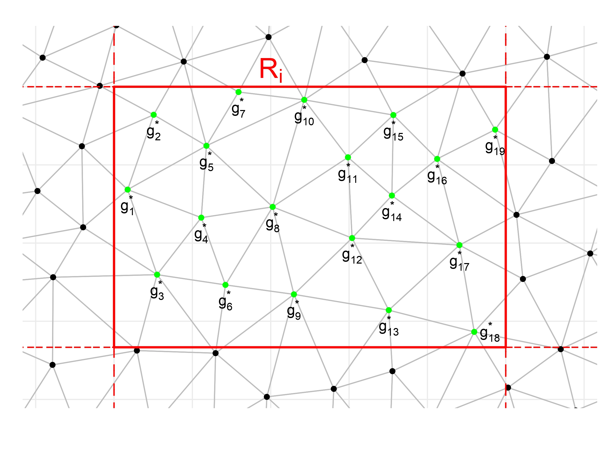

```{r setup, include=FALSE}
knitr::opts_chunk$set(echo = FALSE, warning = FALSE, message = FALSE)
library(patchwork)
library(ggplot2)
library(viridis)
library(kableExtra)
library(terra)
library(rnaturalearth)
library(exactextractr)
library(sf)
library(tidyterra)
library(fmesher)
library(INLA)
library(INLAspacetime)
library(curl)

pkg <- function(x) {
  if (knitr::is_html_output()) {
    sprintf("<a href='https://CRAN.R-project.org/package=%s'><code>%s</code></a>", x, x)
  } else {
    sprintf("\\texttt{%s}", x)
  }
}

#knitr::write_bib(c(.packages()), "packages.bib",prefix = getOption("knitr.bib.prefix", "R-"))
```

```{=latex}
\nocite{R-patchwork,R-ggplot2,R-viridis,R-kableExtra,R-terra,R-rnaturalearth,R-sf,R-tidyterra,R-fmesher,R-INLA,R-INLAspacetime,R-curl,R-exactextractr}
```

# Introduction

Air pollution is a major public health concern. Recent estimates from the State of Global Air 2025 report suggest that air pollution contributed to 7.9 million deaths worldwide in 2023, highlighting it as one of the leading environmental risk factors for death [@hei2025soga]. Long term exposure to PM2.5 has been consistently associated with increased all cause mortality and with diseases such as respiratory infections, chronic obstructive pulmonary disease, ischemic heart disease, lung cancer, and stroke [@cohen2017; @burnett2018]. In many settings, PM2.5 is studied together with other key pollutants, especially PM10 and ozone, which are also linked to adverse health outcomes. Ozone has been associated with all cause, cardiovascular, and respiratory mortality [@gryparis2004acute; @nuvolone2018effects], and particulate matter, including PM2.5 and PM10, shows harmful effects even under short term exposure, contributing to mortality, morbidity, and adverse birth outcomes [@pascal2014shortterm; @lu2015systematic; @feng2016health]. Finally, aerosols are often summarized through Aerosol Optical Depth (AOD), a unitless measure widely available from satellite and reanalysis products that provides broad spatio-temporal coverage and is frequently used to support air quality monitoring alongside ground observations [@rapetal2013aod].

Despite their importance, many air quality products are only available on coarse spatial or spatio temporal supports, for example CAMS reanalysis products [@inness2019cams]. This can hide local variation and make it difficult to identify small areas with high concentrations. Disaggregation models address this problem by assuming an underlying latent process at a finer scale and linking it to aggregated observations through an aggregation operator, while providing uncertainty quantification and allowing the inclusion of high resolution covariates. In this paper, we focus on a practical R workflow based on the models developed in [@RodriguezAvellanedaMult; @avellaneda2025bayesianspatiotemporaldisaggregationmodeling], and we show how to implement spatial, multivariate, and spatio temporal disaggregation with `r pkg("INLA")`.

INLA stands for Integrated Nested Laplace Approximation, a deterministic alternative to MCMC for Bayesian inference in latent Gaussian models. Instead of generating long Markov chains, INLA uses nested Laplace approximations and numerical integration to obtain accurate posterior marginals for the fixed effects, hyperparameters, and the latent field, which makes it especially convenient for spatial and spatio-temporal models with many latent variables. In practice, we carry out inference using the R-INLA implementation, available through the package `r pkg("INLA")`, which provides the SPDE tools used throughout this paper [@rue_et_al_r_inla_2009].

Disaggregation has been studied under several modeling strategies. A common geostatistical approach assumes an underlying continuous latent process and links areal observations to it through a change-of-support operator, which allows prediction on finer grids but can be computationally demanding when aggregation integrals require approximation [@tanaka2019spatiallya; @yousefi2019multitaska]. In R the package `r pkg("disaggregation")` provides a streamlined workflow for Bayesian spatial disaggregation regression implemented in Template Model Builder (TMB). Inference is based on a Laplace approximation, and the paper shows that running a full MCMC alternative via tmbstan can be prohibitively slow in comparison (e.g., about 56 hours for MCMC versus 85 seconds with the Laplace approach in one example) [@nandi2023disaggregation]. The package focuses on spatial disaggregation, and extensions to spatio-temporal settings are discussed as future work, so it does not directly cover the multivariate and spatio-temporal models in this paper [@nandi2023disaggregation].

Across the settings in this paper, our disaggregation is built around the Stochastic Partial Differential Equation (SPDE) approach. We assume an underlying continuous latent Gaussian field that represents the process at the fine scale, but we only observe it through measurements aggregated over regions (and, in the spatio-temporal case, over time windows). The SPDE formulation lets us represent this latent field on a triangulated mesh as a Gaussian Markov random field, and the aggregation step is handled through a sparse projection matrix that links the mesh to the observed supports. Covariates are included at the fine scale, so the model can explain local variation using information available at higher resolution than the observations, and after inference we obtain predictions on a finer grid with uncertainty quantification. Although we focus on air pollution applications here, the same workflow can be used in many other settings where data are observed on coarse supports but decisions require finer-scale estimates [@forlani2020joint; @zhong2023spatial; @gomez2019multivariate].

The remainder of the paper is organized as follows. In Section \@ref(sec:methods) we summarize the main disaggregation framework and how it is implemented in R-INLA. We then present three worked examples: Section \@ref(sec:spatial-dis) covers a univariate spatial disaggregation of PM2.5 in Portugal, Section \@ref(sec:mult) extends the approach to a multivariate model for PM2.5, PM10, and ozone in Portugal, and Section \@ref(sec:spatio-temp) presents a spatio-temporal disaggregation example for AOD at 550 nm in India. We close with a short conclusions section, summarizing practical takeaways and possible extensions.

We start with a univariate spatial example, where we disaggregate PM2.5 concentrations in Portugal from the coarse CAMS grid to a finer resolution, downscaling from 0.1$^\circ$ to 0.02$^\circ$, which corresponds approximately to a change from 10 km to 2 km. We then extend the framework to a multivariate setting using the Linear Model of Coregionalization (LMC), jointly disaggregating PM2.5, PM10, and ozone over Portugal using the same CAMS product [@inness2019cams], targeting the same spatial refinement. Finally, we move to the spatio-temporal setting and disaggregate Aerosol Optical Depth (AOD) at 550 nm over India using the EAC4 reanalysis from ECMWF [@inness2019cams]. In that example, we refine the spatial resolution from $0.75^\circ$ to $0.25^\circ$ and the temporal resolution from 3-hourly to hourly, producing spatio-temporal predictions at intermediate time points that are not available in the original product.

# Methodology {#sec:methods}

In this section, we present the theoretical framework behind our spatial, multivariate, and spatio-temporal disaggregation models. We start with the univariate spatial case, which introduces the main idea of a latent continuous field linked to aggregated observations through an aggregation operator. Building on this setup, we extend the model to the multivariate setting using the Linear Model of Coregionalization (LMC) to jointly represent multiple pollutants. We then return to the univariate formulation and extend it to the spatio-temporal case, where the latent field evolves over space and time. Next, we briefly describe the latent structures used in the spatial and spatio-temporal settings, and we close by outlining how inference is performed with `r pkg("INLA")`.

## Spatial disaggregation model {#sec:uni-mod}

Let $Y_i$ denote the observations in spatial regions $i=1,\ldots,N$. We assume that underlying these observations there is a continuous latent spatial field that is observed only at an aggregated resolution. This latent continuous model can be expressed as a combination of fixed and random effects as

\begin{equation}
\begin{aligned}
y(\mathbf{s})
&= \boldsymbol{\beta}^\top \mathbf{X}(\mathbf{s}) + z(\mathbf{s}) \\
&=
\begin{bmatrix}
\beta_0 & \beta_1 & \cdots & \beta_p
\end{bmatrix}
\begin{bmatrix}
1 \\ x_1(\mathbf{s}) \\ \vdots \\ x_p(\mathbf{s})
\end{bmatrix}
+ z(\mathbf{s}).
\end{aligned}
(\#eq:spa-cont)
\end{equation}

where $\beta,X(\mathbf{s})$ represents the $p$ fixed effects (including the intercept $\beta_0$), and $z(\mathbf{s})$ denotes a spatial Gaussian process. 

From the continuous spatial process $y(\mathbf{s})$, we define an aggregated process over a spatial region $R \subseteq \mathbb{R}^2$ as

\begin{equation}
z(R) = \frac{1}{|R|}\int_{R} z(\mathbf{s}),\mathrm{d}\mathbf{s},
(\#eq:spa-agg)
\end{equation}

with $|R| = \int_{R} \mathrm{d}\mathbf{s}$. We then assume that the observed values arise from the aggregation of the continuous latent process together with a measurement error term. In this case, Equation \@ref(eq:spa-cont) aggregates to the discrete process

\begin{equation}
y(R_i) = \beta \, X(R_i) + z(R_i) + v_i,
(\#eq:spa-areal)
\end{equation}

where $X(R_i)$ represents the average covariates over the spatial region $R_i$, $z(R_i)$ is the aggregated process defined in Equation \@ref(eq:spa-agg), and $v_i$ is an unstructured noise term, modeled as $v_i \sim \mathrm{N}(0, \sigma^2_{\epsilon})$. 

## Spatial structure of the spatial Gaussian process {#sec:spa-matern}

The spatial random effect $z(\mathbf{s})$ in the univariate model (Equation \@ref(eq:spa-cont)) and the independent components $z_j(\mathbf{s})$ in the multivariate model (Equation \@ref(eq:mult-cont)), for $j=1,\ldots,M$, are modeled as zero-mean Gaussian processes with Matérn spatial dependence [@matern_1960]. Without loss of generality, we describe the structure for a generic field $\hat{z}(\mathbf{s})$. For two locations $\mathbf{s}_i$ and $\mathbf{s}_k$, we assume the Matérn covariance

\begin{equation}
\text{Cov}(\hat{z}(\mathbf{s}_i), \hat{z}(\mathbf{s}_k)) =
\frac{\sigma^{2}}{2^{\nu-1}\Gamma(\nu)}
\left(\kappa\left\|\mathbf{s}_i-\mathbf{s}_k\right\|\right)^{\nu}
K_{\nu}\left(\kappa\left\|\mathbf{s}_i-\mathbf{s}_k\right\|\right),
\end{equation}

where $\sigma^{2}$ is the marginal variance, $K_{\nu}(\cdot)$ is the modified Bessel function of the second kind, and $\nu>0$ controls the smoothness of the field. In practice, $\nu$ is often fixed for stability. The parameter $\kappa>0$ controls the spatial range, and a common practical definition is $\rho = \sqrt{8\nu}/\kappa$. This Matérn specification is also convenient for computation, since it has a direct SPDE representation that can be implemented efficiently on a triangulated mesh within the INLA framework.

## Implementation of spatial disaggregation with INLA-SPDE {#sec:inla-inf-spa}

For the univariate spatial model in Section \@ref(sec:uni-mod) and the multivariate spatial model in Section \@ref(sec:mult-mod), inference is performed using the SPDE approach implemented in `r pkg("INLA")`. As described in Section \@ref(sec:spa-matern), we assume a Matérn covariance structure for the spatial random effect, that is, for $z(\mathbf{s})$ in the univariate case and for each independent component $z_j(\mathbf{s})$, $j=1,\ldots,M$, in the multivariate case. The main idea is that a Matérn Gaussian process can be represented as the solution of an SPDE [@whittle1963stochastic]. Since the same construction applies to each latent field, without loss of generality we describe it for a generic field $\hat{z}(\mathbf{s})$.

A Matérn Gaussian random field can be characterized through the SPDE
\begin{equation}
\left(\kappa^2-\Delta\right)^{\alpha / 2}\big(\tau\,\hat{z}(\mathbf{s})\big)=\vartheta(\mathbf{s}),
(\#eq:spde)
\end{equation}
where $\vartheta(\mathbf{s})$ is spatial white noise, $\alpha$ controls smoothness (with $\nu=\alpha-d/2$ in dimension $d$), and $(\kappa,\tau)$ control the range and marginal variance of the field. The SPDE representation is convenient because `r pkg("INLA")` approximates $\hat{z}(\mathbf{s})$ on a triangulated mesh, leading to a Gaussian Markov random field with a sparse precision matrix and fast inference [@rue_et_al_r_inla_2009].

Let $\{\mathbf{s}^*_k\}_{k=1}^G$ be the mesh vertices and $\{\psi_k(\mathbf{s})\}$ the associated piecewise linear basis functions. The latent field is approximated by
\begin{equation}
\hat{z}(\mathbf{s}) \approx \sum_{k=1}^{G}\psi_k(\mathbf{s})\,\hat{z}_k,
(\#eq:basis)
\end{equation}
where $\hat{z}_k$ are Gaussian weights defined on the mesh nodes. In disaggregation models we do not observe $\hat{z}(\mathbf{s})$ directly. Instead, the data are available as spatial averages over regions $R_i$. Following [@moraga2017geostatistical], the key step is to link the areal quantity $\hat{z}(R_i)=\frac{1}{|R_i|}\int_{R_i}\hat{z}(\mathbf{s})\,\mathrm{d}\mathbf{s}$ to the mesh representation. Substituting Equation \@ref(eq:basis) into this average gives the core approximation
\begin{align}
\begin{split}
\hat{z}(R_i)
&= \frac{1}{|R_i|}\int_{R_i} \hat{z}(\mathbf{s})\,\mathrm{d}\mathbf{s}
 = \frac{1}{|R_i|}\int_{R_i} \sum_{k=1}^{G} \psi_k(\mathbf{s})\,\hat{z}_k \,\mathrm{d}\mathbf{s} \\
&= \frac{1}{|R_i|}\sum_{k=1}^{G}\left(\int_{R_i} \psi_k(\mathbf{s})\,\mathrm{d}\mathbf{s}\right)\hat{z}_k \\
&\approx \frac{1}{|R_i|}\sum_{k=1}^{G}\left(\int_{R_i} \psi_k(\mathbf{s}^*_k)\,1_{\{\psi_k(\mathbf{s})\neq 0\}}\,\mathrm{d}\mathbf{s}\right)\hat{z}_k \\
&= \sum_{k=1}^{G}\frac{|R_{ik}|}{|R_i|}\,\hat{z}_k
 = \sum_{k=1}^{G} A_{ik}\,\hat{z}_k,
\qquad \text{with}\qquad
A_{ik}=\frac{|R_{ik}|}{|R_i|}.
\end{split}
(\#eq:des)
\end{align}
The matrix $\mathbf{A}=(A_{ik})$ is the projection (aggregation) matrix that maps the latent field from the mesh nodes to the areal supports. By construction, $A_{ik}\ge 0$ and each row sums to one, $\sum_k A_{ik}=1$. In practice, when the mesh is close to regular, we often use the simplified choice $A_{ik}=1/n_i$ for the $n_i$ mesh nodes that fall inside region $R_i$. Figure (\@ref(fig:mesh-example)) illustrates this idea for a rectangular region $R_i$ overlaid with a triangular mesh: the green vertices ($g_1,\ldots,g_{19}$) are the mesh nodes that fall inside $R_i$, while the black vertices lie outside. In this setting, we can simplify the projection matrix as by assigning equal weight to each node inside the region. Since there are 19 vertices inside $R_i$, the $i$th row of $\mathbf{A}$ has $A_{ik}=1/19$ for those 19 nodes and $A_{ik}=0$ for all other nodes.

```{r mesh-example, fig.cap="Example of a rectangular region $R_i$ overlaid on a triangulated mesh, where the green vertices are the mesh nodes inside $R_i$ and are used to define the projection matrix A.", fig.align="center", out.width="60%", fig.align="center"}

```

This construction is the same for the univariate and multivariate spatial models. In the univariate case, $\mathbf{A}$ links the latent field to the areal observations in Equation \@ref(eq:mult-areal). In the multivariate case, the same projection idea is applied to each independent component $z_j(\mathbf{s})$, $j=1,\ldots,M,$ and the LMC structure is then obtained by combining these projected components according to Equation \@ref(eq:mult-cont). In `r pkg("INLA")`, these mappings are implemented by defining the SPDE model on the mesh and supplying the projection matrices in the `inla.stack()` objects for estimation and prediction.

## INLA essentials: installation and main workflow {#sec:inla-essentials}

Before running the examples in this paper, we need to install `r pkg("INLA")` and a small set of supporting packages for handling rasters, vector geometries, and meshes. Note that `r pkg("INLA")` is installed from the INLA repository (not from CRAN). The spatio-temporal example additionally uses `r pkg("INLAspacetime")`.

```{r inla-install, eval=FALSE, echo=TRUE}
# Install INLA from the INLA repository (not CRAN)
install.packages(
  "INLA",
  repos = c(getOption("repos"), INLA = "https://inla.r-inla-download.org/R/stable"),
  dependencies = TRUE
)

# Only needed for the spatio-temporal example
install.packages("INLAspacetime")

# Quick check
library(INLA)
inla.version()
```

Once the data and covariates are ready, the INLA workflow in this paper follows a fairly standard sequence. First, we build a triangulated mesh to represent the latent field with the SPDE approach. In our examples, the mesh is constructed over the study region using functions such as `fm_hexagon_lattice()` and `fm_mesh_2d()` (from `r pkg("fmesher")`), choosing parameters like `max.edge` and `offset` so the mesh is finer than the original data support. In the spatio-temporal case, we also create a one-dimensional temporal mesh with `inla.mesh.1d()` and combine these together to have a spatio-temporal mesh.

Next, we define prediction locations on the target resolution, using helpers such as `st_make_grid()`, `seq()`, and `expand.grid()`. For the spatio-temporal example, we extend the prediction set by combining the spatial prediction grid with a time index, so the same locations are repeated across the time points where we want predictions. Finally, for both estimation and prediction, the covariates must be available on the same supports as the response. In the spatio-temporal case, if a covariate does not vary in time, we simply replicate its spatial values across the time index so it matches the space–time prediction set.

Model specification in INLA is done by translating the linear predictor into a formula and defining the latent SPDE component. In the spatial models, the Matérn SPDE is created with `inla.spde2.matern()`, and the latent field enters the formula through terms like `f(s, model = spde)`. In the multivariate example, the LMC structure is implemented by combining shared and pollutant-specific fields and using `copy=` terms (with `fixed=FALSE`) to estimate the scaling parameters. In the spatio-temporal example, we use `r pkg("INLAspacetime")` to define a spatio-temporal SPDE model (via `stModel.define()`) and include it in the formula through `f(st, model = stmodel)`.

To connect the data support (coarse cells, and coarse time windows in the spatio-temporal case) to the mesh representation, we build projection matrices and assemble the stacks. Spatially, the key object is the projection matrix (e.g., `A.m` from regions to mesh nodes, and `A.pr` from mesh nodes to prediction points). In practice, we pass these matrices to `inla.stack()` through its `A=` argument, and we build separate stacks for estimation and prediction, which are then combined into a single object (e.g., `stk.full`). For the spatio-temporal setting, we build the spatial and temporal projection components separately and combine them (for example using `kronecker()`) to obtain the full spatio-temporal projection matrix used in the stacks.

Finally, we fit the model with `inla()`. The stacked data are provided with `inla.stack.data()`, and the corresponding projection matrix is passed through `control.predictor = list(A = inla.stack.A(...), compute = TRUE)` so INLA returns fitted values and predictions. Predictions are retrieved using `inla.stack.index()` to select the prediction rows, and then extracting the posterior summaries from `res$summary.linear.predictor`. Fixed-effect summaries are obtained from `res$summary.fixed`, and the same workflow extends naturally from the univariate spatial example to the multivariate and spatio-temporal settings by changing the model formula and the stack/projection structure.

# Spatial disaggregation of PM2.5 concentration in Portugal {#sec:spatial-dis}

In this section, we illustrate spatial disaggregation by improving the resolution of PM2.5 concentrations in Portugal from 10km to 2km. We used annual air quality reanalysis data for Portugal provided by the Copernicus Atmosphere Monitoring Service (CAMS) [@inness2019cams], a high-resolution product developed by the European Centre for Medium-Range Weather Forecasts (ECMWF). This publicly accessible dataset, available at https://ads.atmosphere.copernicus.eu/datasets/cams-europe-air-quality-reanalyses, integrates satellite observations and auxiliary information to get estimations of air pollution levels in a very corase resolution.

## PM2.5 disaggregation model

The main objective of this model is to perform spatial disaggregation by increasing the resolution from $0.1^\circ$ to $0.02^\circ$, which corresponds approximately to a change from 10 km to 2 km, using `r pkg("INLA")`. We also include elevation as a high-resolution covariate to help explain local variation in PM2.5 and improve the disaggregation. We assume the existence of a latent continuous spatial process for PM2.5 that is observed only through aggregated measurements. The link between the latent field and the areal observations is defined through Equations \@ref(eq:spa-cont), \@ref(eq:spa-agg), and \@ref(eq:spa-areal). Inference is then performed using the projection (aggregation) matrix described in Section \@ref(sec:inla-inf-spa).

\begin{equation}
\text{pm}_{2.5}(\mathbf{s}) = \beta_0 + \beta_1\,\text{elevation}(\mathbf{s}) + z(\mathbf{s}) + e(\mathbf{s}) (\#eq:app-pm25)
\end{equation}

where $\beta_0$ is an intercept and $\beta_1$ is the regression coefficient associated with elevation. The term $z(\mathbf{s})$ represents a spatially structured random effect, modeled as a zero mean Gaussian process with a Mat\'ern covariance function, and $e(\mathbf{s})$ is an unstructured error term, modeled as a zero mean Gaussian process that is independent across space.

## Data acquisition and preprocessing {#sec:spatial-data-pre}

In this section, we describe how to obtain the PM2.5 dataset and the covariate information used in our models. We first show how to download and preprocess the air pollution data, and then we explain how to collect elevation data preprocessing for modeling using `r pkg("INLA")`.

### Observed PM2.5 values in Portugal 

To download the data, you need to create an account on the Atmospheric Data Store (ADS), accept the terms and conditions, and obtain the "Licence to use Copernicus Products." After setup, the data can be downloaded using the Python API. More details on setting up the API are available at https://ads.atmosphere.copernicus.eu/how-to-api. In our request, the argument `variable = ["particulate_matter_2.5um"]` selects PM2.5 concentrations, `model = ["ensemble"]` specifies the ensemble product, `level = ["0"]` indicates the surface level, `type = ["validated_reanalysis"]` requests the validated reanalysis product, and `year = ["2019"]` and `month = ["01"]` restrict the download to January 2019.

After downloading and unzipping the data, we use the `r pkg("terra")` package to read the `nc` file. NetCDF (Network Common Data Form) files are widely used for storing multi-dimensional scientific data, such as climate or GIS datasets, because they are self-describing, portable, and efficient for large arrays. The original dataset contains hourly samples for the 31 days of January 2019, totaling 744 observations. Since our focus is on identifying mean trends, we calculated the average PM2.5 concentration for each location. As the original data covers the entire European continent, we cropped the spatial extent to focus specifically on Portugal. To provide better geographical context in our visualizations, we also included the administrative boundaries of Portugal and Spain for clear regional identification using packages `r pkg("rnaturalearth")` and `r pkg("sf")`. Finally for plotting we used `r pkg("ggplot2")`, `r pkg("tidyterra")` and `r pkg("viridis")` packages.

To simplify replication and avoid the ADS download and NetCDF preprocessing steps, we provide the preprocessed dataset as `pm2p5_portugal.csv`, which contains the processed PM2.5 values in CSV format.

```{r pm25-plot,fig.align='center', fig.cap="Mean PM2.5 concentration in Portugal during January 2019. Country boundaries for Portugal and Spain are overlaid for geographic reference.", include=TRUE, echo=TRUE}
# Define the squared study region and convert to dataframe
sq <- ext(-9.65, -6.05, 36.85, 42.25)

# Read the dataset and compute mean value (From source)
# r <- rast("data/cams.eaq.vra.ENSa.pm2p5.l0.2019-01.nc")
# r_mean <- app(r, mean, na.rm = TRUE)
# r_sq <- crop(r_mean, sq)
# df <- as.data.frame(r_sq, xy = TRUE, na.rm = TRUE)
# df <- df[order(df$y, df$x), ]
# names(df) <- c("longitude", "latitude", "pm2p5")
# write.csv(df, "data/pm2p5_portugal.csv", row.names = FALSE)

# Read dataset from preprocess file
df <- read.csv("data/pm2p5_portugal.csv")
r_sq <- rast(df[, c("longitude", "latitude", "pm2p5")])

# Get portugal and Spain borders
boundary <- ne_countries(scale="medium", returnclass="sf") |>
  subset(admin %in% c("Portugal", "Spain")) |>
  st_transform(4326)

# Plot PM2.5 contamination and boundary countries
ggplot() +
  geom_spatraster(data = r_sq) +
  geom_sf(data = boundary, fill = NA, color = "black") +
  scale_fill_viridis_c(name = "PM2.5") +
  theme(
    axis.text.x = element_text(angle = 45, hjust = 1, vjust = 1, size = 9)
  ) +
  coord_sf(xlim = c(xmin(sq), xmax(sq)),
           ylim = c(ymin(sq), ymax(sq)),
           expand = FALSE)
```

Figure (\@ref(fig:pm25-plot)) shows the spatial distribution of mean PM2.5 over the Portugal for January 2019. Higher concentrations are observed in northern Portugal. The map is provided on the original CAMS grid (about 0.1$^\circ$, roughly 10 km), which is relatively coarse for local-scale interpretation; we therefore target a finer resolution of 0.02$^\circ$ (approximately 2 km) using spatial disaggregation.

### Covariates {#sec:cov}

We incorporate high resolution elevation data, at approximately $60$m resolution, from the EuroDEM product maintained by EuroGeographics [@eurogeographics2023eurodem] that is available in the following website https://www.mapsforeurope.org/datasets/euro-dem. Elevation is included as a covariate to relate PM2.5 concentrations with changes in altitude and to improve the explanatory power of the spatial disaggregation model across the study region. This step can be computationally demanding because EuroDEM is provided at very fine resolution and covers all of Europe, and it must be reprojected to EPSG:4326 before cropping. To reduce computation time, we provide a preprocessed version already reprojected, aggregated and cropped to the study region called `eurodemc.tif`. Figure (\@ref(fig:elev-plot-1)) shows the resulting elevation raster over Portugal, with values reported in meters.

```{r elev-plot-1, fig.cap="EuroDEM elevation raster over Portugal (meters), cropped to the study region and used as a covariate in the disaggregation model.", fig.align='center', include=TRUE, echo=TRUE}
# Time consuming: This preprocessing takes roughly 40 minutes to be executed
# r <- rast("data/eurodem.tif")
# r_map <- project(r, "EPSG:4326")
# writeRaster(r_map, "data/eurodemp.tif", overwrite = TRUE)
# r_map <- rast("data/eurodemp.tif")
# r_crop <- crop(r_map, sq_sf)
# r_ag <- aggregate(r_crop, fact = 2, fun = mean, na.rm = TRUE)
# writeRaster(r_ag, "data/eurodemc.tif", overwrite = TRUE)

# Reading elevation dataset
r_crop <- rast("data/eurodemc.tif")
r_crop[is.na(r_crop)] <- 0

plot(r_crop)
```

## INLA modeling

After obtaining the PM2.5 dataset and the elevation covariate, we need to prepare several additional objects before fitting the disaggregation model with `r pkg("INLA")`. We proceed in the following order. First, we define the input grid, build the spatial mesh, and create the prediction locations on the finer resolution grid. Next, we align the elevation covariate with both the input grid and the prediction grid. We then specify the SPDE in the spatial mesh, construct the projection matrices and assemble the corresponding `INLA` stacks for estimation and prediction. Finally, we fit the model with `r pkg("INLA")` and summarize the results, and we compare the coarse input field with the disaggregated predictions on the finer scale.

### Input grid, mesh, and prediction locations {#sec:mesh}

The first step in the disaggregation workflow is to construct an input grid that matches the support of the observed data. Using the dataframe `df`, we build a squared grid as an `sf` object with the same spatial extent and dimensions as the original dataset. The second step is to build a spatial mesh that is finer than the initial resolution of the data, as shown on the right side of Figure (\@ref(fig:mesh-plot)). This panel displays a portion of the triangulated mesh, represented by black segments, together with the original gridded support, shown in red. Finally, to achieve the target disaggregation from 0.1$^\circ$ to 0.02$^\circ$, we define the prediction points on the desired high resolution grid. The variable `spf` controls the disaggregation factor. Specifically, setting $\texttt{spf}=5$ increases the resolution within each original cell by a factor of $5 \times 5 = 25$, as illustrated on the left side of Figure (\@ref(fig:mesh-plot)), where red lines denote the original grid and blue dots indicate the prediction locations under the disaggregated scenario.

```{r mesh-plot, fig.cap="Spatial discretization for disaggregation. Original grid support is shown in red. Prediction points for `spf=5` are shown in blue (left), and a portion of the triangulated mesh is shown in black (right)", fig.align='center', include=TRUE, echo=TRUE}
# Initial squared grid
map <- st_as_sf(st_make_grid(sq, n = c(length(unique(df$longitude)),
                               length(unique(df$latitude)))))
st_geometry(map) <- "geometry"
st_crs(map) <- "EPSG:4326"

# Spatial mesh
sq_sf <- st_as_sf(as.polygons(sq))

hexpts <- fm_hexagon_lattice(
  bnd = st_buffer(sq_sf, 0.1),
  edge_len = 0.05
)

mesh <- fm_mesh_2d(
  loc = hexpts,
  max.edge = 0.1,
  offset = 0.05
)

# prediction points

spf <- 5 # spatial factor
def <- abs(unique(df$latitude)[2]-unique(df$latitude)[1])/2

x <- seq(min(df$longitude) - def*((spf-1)/spf),
         max(df$longitude) + def*((spf-1)/spf),
         length.out = length(unique(df$longitude))*spf)

y <- seq(min(df$latitude) - def*((spf-1)/spf),
         max(df$latitude) + def*((spf-1)/spf),
         length.out = length(unique(df$latitude))*spf)

dp <- as.matrix(expand.grid(x, y))
dpdf <- data.frame(dp)
names(dpdf) <- c("x", "y")

dpdf_sf <- st_as_sf(dpdf, coords = c("x", "y"), crs="EPSG:4326")
dpdf_sf$id <- 1:nrow(dpdf)

# Plots
par(mfrow = c(1, 2), pty = "s")
plot(mesh, xlim = c(-9.65, -9.45), ylim = c(36.5, 37.5))
plot(map$geometry, add = TRUE, border = "red", lwd = 2)

plot(map$geometry, border = "red", lwd = 2 , xlim = c(-9.7, -9.5),
     ylim = c(36.8, 37))
plot(dpdf_sf$geometry, add = TRUE, col = "blue", lwd = 1)

```

### Elevation covariate on input and prediction grids

To incorporate this covariate within the disaggregation framework, we align its spatial support with both the original CAMS grid and the high-resolution prediction grid. For this purpose, we use the `exactextractr` package, which provides efficient tools for extracting and summarizing raster values over polygonal features. We compute the mean elevation within each 0.1$^\circ$ CAMS input cell and within each 0.02$^\circ$ prediction cell, so that the covariate is available at the same spatial support as both the observed and predicted quantities. Figure (@ref(fig:elev-plot-2)) illustrates the resulting elevation covariate over Portugal, with the input grid shown on the left and the prediction grid shown on the right.

```{r elev-plot-2, fig.cap="Elevation over Portugal on the input grid (left) and the prediction grid (right), with country boundaries for reference.", fig.align='center', include=TRUE, echo=TRUE}
# Time consuming: this part takes around 1 minute to be executed
# Converting to Raster* object
r_ras <- raster::raster(r_crop)

# Extract elevation values in the original dataset
map$elev <- exact_extract(r_ras, map, "mean", progress = FALSE)

# Create the prediction dataset in sf format
map_pred <- st_as_sf(st_make_grid(sq, n = c(length(unique(df$longitude)),
                               length(unique(df$latitude)))*spf))
st_crs(map_pred) <- "EPSG:4326"

# Extract elevation values in the prediction dataset
map_pred$elev <- exact_extract(r_ras, map_pred, "mean", progress = FALSE)

# Plot elevation in the input grid
p1 <- ggplot(map) +
  geom_sf(aes(fill = elev), color = NA) +
  scale_fill_viridis_c(name = "Elevation (m)") +
  geom_sf(data = boundary, fill = NA, color = "black") +
  coord_sf(xlim = c(-10, -6), ylim = c(36.5, 42.5),
           expand = FALSE) +
  theme(
    axis.text.x = element_text(angle = 45, hjust = 1, vjust = 1, size = 9),
    plot.margin = margin(t = 5.5, r = 5.5, b = 18, l = 5.5)
  )

# Plot elevation in the prediction grid
p2 <- ggplot(map_pred) +
  geom_sf(aes(fill = elev), color = NA) +
  scale_fill_viridis_c(name = "Elevation (m)") +
  geom_sf(data = boundary, fill = NA, color = "black") +
  coord_sf(xlim = c(-10, -6), ylim = c(36.5, 42.5),
           expand = FALSE) +
  theme(
    axis.text.x = element_text(angle = 45, hjust = 1, vjust = 1, size = 9),
    plot.margin = margin(t = 5.5, r = 5.5, b = 18, l = 5.5)
  )

p1 + p2
```

### SPDE especification, projection matrices and INLA stacks {#sec:mod-inp}

To fit the model described in Equation \@ref(eq:app-pm25), we use the triangulated mesh defined before in Section \@ref(sec:mesh). We then construct the SPDE representation on this mesh, and build the corresponding projection matrices that link the observation locations and the prediction points to the mesh nodes. Finally, we combine the response, covariates, and latent components into \texttt{INLA} stacks, which are used to perform model estimation and prediction.

```{r input-inla, include=TRUE, echo=TRUE}
# Construct the SPDE in the spatial mesh
spde <- inla.spde2.matern(mesh = mesh, alpha = 2, constr = TRUE)

n.ar <- nrow(map) # number of initial regions
nv <- mesh$n # number of mesh nodes

mesh_sf <- st_as_sf(data.frame(x=mesh$loc[, 1], y=mesh$loc[, 2], id=1:nv),
                    coords = c("x", "y"), crs="EPSG:4326")

# Projection matrix from initial data to the triangulated mesh
A.m <- matrix(0, n.ar, nv)
inter <- as.list(st_contains(map[, c()], mesh_sf))

for (i in 1:n.ar){
  idx <- inter[[i]]
  A.m[i, idx] <- 1/length(idx)
}
A.m <- as(A.m, "dgCMatrix")

# Projection matrix from the mesh to the predicted points
A.pr <- inla.spde.make.A(mesh = mesh, loc = dp)

# Stack for estimation
stk.est <- inla.stack(
  data = list(y = df$pm2p5),
  A = list(A.m, A.m, 1),
  effects = list(
    s = 1:nv,
    b0 = rep(1, nv),
    elev = map$elev/1000 # convert m to km
  ),
  tag = "y")

# Stack for prediction
stk.pred <- inla.stack(
  data = list(y = NA),
  A = list(A.pr, A.pr, 1),
  effects = list(
    s = 1:nv,
    b0 = rep(1, nv),
    elev = map_pred$elev/1000 # convert m to km
    ),
  tag = "y.pred")

# Stack for estimation and prediction
stk.full <- inla.stack(stk.est, stk.pred)
```

### Model fitting with INLA

Now, we translate Equation \@ref(eq:app-pm25) into an `INLA` formula, where the symbol `~` defines the linear predictor for the response $y$. The term `0 + b0` adds an explicit intercept, with `b0` being a column of ones included in the stack. The term `elev` represents elevation as a fixed effect, and `f(s, model = spde)` specifies the spatial random effect on the mesh using the SPDE model. We fit the model with `inla()` using the stacked data object `stk.full`, and set `family = "gaussian"` because $y$ is continuous. If the response $y$ is non Gaussian, such as counts modeled with a Poisson variable, the model specification need to be adapted. For these settings, we recomend using the package `r pkg("inlabru")` along `r pkg("INLA")` that provides a workflow to deal with that kind of data [@inlabru].

```{r fixed-table, tab.cap="Posterior summary of the fixed effects (intercept and elevation coefficient) for the PM2.5 concentration model in Portugal.", include=TRUE, echo=TRUE}
# Time consuming: This preprocessing takes roughly 5 minutes to be executed

# INLA formula
form <- y ~ 0 + b0 + elev + f(s, model = spde)

# Fitting and prediction
res <- inla(
  formula=form,
  data = inla.stack.data(stk.full, spde = spde),
  family = "gaussian",
  control.predictor = list(A = inla.stack.A(stk.full),
                           compute = TRUE, link = 1)
)

# Summary for the fixed effects
res$summary.fixed |>
  knitr::kable(digits = 3) |>
  kable_styling(full_width = FALSE)
```

Table (\@ref(tab:fixed-table)) summarizes the posterior distributions of the fixed effects. The posterior mean of the intercept $\beta_0$ is 8.34~$\mu$g/m$^3$, which represents the mean PM2.5 level over Portugal when elevation is zero. The posterior credible interval for the elevation coefficient excludes zero, indicating a clear association between elevation and PM2.5. The posterior mean is $-0.44$, implying that an increase of 1~km in altitude is associated with a decrease of about 0.44~$\mu$g/m$^3$ in PM2.5.

### Input data and disaggregated predictions

Figure (\@ref(fig:pred-plot)) compares the coarse input PM2.5 field (left) with the posterior mean predictions from the disaggregation model on the finer grid (right). The disaggregated surface provides a smoother and more detailed representation of spatial variability, while maintaining the main concentration levels and spatial patterns observed in the input data.We also notice that the range of the predicted surface is slightly wider than the range of the input data. This is an important advantage of the disaggregation approach, since it can reveal localized areas with higher or lower concentrations than suggested by the coarse grid, which can be useful for decision makers.

```{r pred-plot, fig.cap="PM2.5 over Portugal on the input grid (left) and disaggregated predictions on the finer grid (right).", fig.align='center', include=TRUE, echo=TRUE}
# get indexes of the response variable
idx <- inla.stack.index(stk.full, 'y.pred')$data

# Input grid
map$pm2p5 <- df$pm2p5

# Prediction
map_pred$pm2p5 <- res$summary.linear.predictor[idx, "mean"]

# Plot for input grid
p1 <- ggplot(map) +
  geom_sf(aes(fill = pm2p5), color = NA) +
  scale_fill_viridis_c(name = "Pm2.5") +
  geom_sf(data = boundary, fill = NA, color = "black") +
  coord_sf(xlim = c(-10, -6), ylim = c(36.5, 42.5),
           expand = FALSE) +
  theme(
    axis.text.x = element_text(angle = 45, hjust = 1, vjust = 1, size = 9),
    plot.margin = margin(t = 5.5, r = 5.5, b = 18, l = 5.5)
  )

# Plot for predictions
p2 <- ggplot(map_pred) +
  geom_sf(aes(fill = pm2p5), color = NA) +
  scale_fill_viridis_c(name = "Pm2.5") +
  geom_sf(data = boundary, fill = NA, color = "black") +
  coord_sf(xlim = c(-10, -6), ylim = c(36.5, 42.5),
           expand = FALSE) +
  theme(
    axis.text.x = element_text(angle = 45, hjust = 1, vjust = 1, size = 9),
    plot.margin = margin(t = 5.5, r = 5.5, b = 18, l = 5.5)
  )

# Combine plots
p1 + p2
```

# Multivariate Spatial disaggregation of PM2.5, PM10 and Ozone concentrations in Portugal. {#sec:mult}

In this section, we extend the previous spatial disaggregation framework to a multivariate setting, jointly modeling PM2.5, PM10, and ozone concentrations in Portugal while increasing the spatial resolution from approximately 10 km to 2 km. We use the same CAMS air quality reanalysis data described in Section \@ref(sec:spatial-dis), now incorporating the additional PM10 and ozone fields. The main difference with respect to the univariate case is that the three pollutants are modeled simultaneously, which allows the model to account for their cross dependence and to borrow strength across variables, improving prediction accuracy.

## Multivariate disaggregation model {#sec:mult-mod}

Let $\mathbf{Y}_i = [Y_{1i},\ldots,Y_{Mi}]^\top$ denote the multivariate observations available for spatial regions $R_i$, $i=1,\ldots,N$. We assume that these areal observations arise from an underlying continuous $M$-dimensional latent spatial process $\mathbf{y}(\mathbf{s})=[y_1(\mathbf{s}),\ldots,y_M(\mathbf{s})]^\top$ observed in the aggregated locations. Following the idas of the univariate spatial case, we represent this latent process using fixed effects and a multivariate spatial random effect,
\begin{equation}
\mathbf{y}(\mathbf{s}) = \mathbf{B}\,\mathbf{X}(\mathbf{s}) + \mathbf{w}(\mathbf{s}),
\end{equation}
where $\mathbf{X}(\mathbf{s})$ collects the covariates (including an intercept) and $\mathbf{B}$ is the corresponding coefficient matrix.

To model the cross-dependence between variables, we use a Linear Model of Coregionalization (LMC) and write the spatial random effect as
\begin{equation}
\mathbf{w}(\mathbf{s})=\mathbf{\Lambda}\,\mathbf{z}(\mathbf{s}),
(\#eq:mult-cont)
\end{equation}
where $\mathbf{z}(\mathbf{s})=[z_1(\mathbf{s}),\ldots,z_M(\mathbf{s})]^\top$ is a vector of independent latent spatial fields and $\mathbf{\Lambda}$ is an $M\times M$ matrix that controls the multivariate spatial structure. Under a common identifiability choice, $\mathbf{\Lambda}$ is taken as lower triangular with ones on the diagonal, so that
\begin{equation}
\begin{bmatrix}
w_1(\mathbf{s})\\
w_2(\mathbf{s})\\
\vdots\\
w_M(\mathbf{s})
\end{bmatrix}
=
\begin{bmatrix}
1 & 0 & \cdots & 0\\
\lambda_{21} & 1 & \cdots & 0\\
\vdots & \vdots & \ddots & \vdots\\
\lambda_{M1} & \lambda_{M2} & \cdots & 1
\end{bmatrix}
\begin{bmatrix}
z_1(\mathbf{s})\\
z_2(\mathbf{s})\\
\vdots\\
z_M(\mathbf{s})
\end{bmatrix},
\end{equation}
which implies
\begin{equation}
\begin{aligned}
w_1(\mathbf{s}) &= z_1(\mathbf{s}),\\
w_2(\mathbf{s}) &= \lambda_{21}z_1(\mathbf{s}) + z_2(\mathbf{s}),\\
&\ \ \vdots\\
w_M(\mathbf{s}) &= \lambda_{M1}z_1(\mathbf{s}) + \lambda_{M2}z_2(\mathbf{s}) + \cdots + z_M(\mathbf{s}).
\end{aligned}
\end{equation}

To link the continuous model with the areal observations, we use the same aggregation idea as in the univariate case. For a region $R_i$, we define the aggregated latent quantities as spatial averages, for example
\begin{equation}
\mathbf{z}(R_i)=\frac{1}{|R_i|}\int_{R_i}\mathbf{z}(\mathbf{s})\,\mathrm{d}\mathbf{s},
(\#eq:mult-agg)
\end{equation}
and we take $\mathbf{X}(R_i)$ as the covariates averaged over the region $R_i$. The multivariate observations $\mathbf{Y}_i$ are then modeled as
\begin{equation}
\mathbf{Y}_i = \mathbf{y}(R_i) = \mathbf{B}\,\mathbf{X}(R_i)+\mathbf{\Lambda}\,\mathbf{z}(R_i)+\mathbf{v}_i,
(\#eq:mult-areal)
\end{equation}
where $\mathbf{v}_i=[v_{1i},\ldots,v_{Mi}]^\top$ is an unstructured error term at the areal level. A common assumption is independent Gaussian noise by component, $v_{ij}\sim \mathrm{N}(0,\sigma^2_{v_j})$, for $j=1,\ldots,M$.

## Multivariate PM2.5, PM10 and Ozone disaggregation model

Building on the univariate spatial disaggregation model, we now extend the spatial framework to a multivariate setting, where several pollutants are modeled jointly (Equations \@ref(eq:mult-cont), \@ref(eq:mult-agg), and \@ref(eq:mult-areal)). As described in Section \@ref(sec:mult-mod), we use a Linear Model of Coregionalization (LMC) to represent the multivariate spatial effect as linear combinations of independent latent spatial processes. This lets the pollutants share spatial components through the LMC coefficients, while still allowing pollutant-specific variation.

In our application, we use this structure to disaggregate PM2.5, PM10, and ozone from $0.1^\circ$ to $0.02^\circ$ resolution, which corresponds approximately to a change from $10$ km to $2$ km. Elevation is included as a covariate for each pollutant, and the LMC is used to combine shared and pollutant-specific spatial effects. Inference follows the same change of support idea as in the univariate case, but applied to each latent component in the LMC using the projection matrix described in Section \@ref(sec:inla-inf-spa). The resulting model is

\begin{align}
\begin{split}
    \text{pm}_{2.5}(\mathbf{s}) & = \alpha_1+\beta_1 \cdot \text{elevation} (\mathbf{s}) + z_{1}(\mathbf{s}) + e_1(\mathbf{s}) \\
    \text{pm}_{10}(\mathbf{s}) & = \alpha_2 +\beta_2 \cdot \text{elevation} (\mathbf{s}) + \lambda_1 z_{1}(\mathbf{s})+z_2(\mathbf{s})+ e_2(\mathbf{s})\\
    \text{ozone}(\mathbf{s}) & = \alpha_3 + \beta_3 \cdot \text{elevation} (\mathbf{s}) + \lambda_2 z_{1}(\mathbf{s})+\lambda_3 z_2(\mathbf{s})+z_3(\mathbf{s}) +e_3(\mathbf{s})
\end{split}
(\#eq:app-mult)
\end{align}

where $\alpha_1$, $\alpha_2$, and $\alpha_3$ are intercepts, and $\beta_1$, $\beta_2$, and $\beta_3$ are regression coefficients for elevation for PM2.5, PM10, and ozone, respectively. The terms $z_1(\mathbf{s})$, $z_2(\mathbf{s})$, and $z_3(\mathbf{s})$ are spatially structured independent random effects, modeled as zero mean Gaussian processes with a Matérn covariance function. The terms $e_1(\mathbf{s})$, $e_2(\mathbf{s})$, and $e_3(\mathbf{s})$ represent unstructured errors, modeled as zero mean Gaussian noise that is independent across space.

## Data acquisition and preprocessing

To download the PM2.5, PM10 and Ozone, we follow the same procedure described in Section \@ref(sec:spatial-data-pre). If the code for the univariate spatial example has already been run, there is no need to repeat the registration or licence acceptance steps. The API request remains the same, except that the `variable` argument must now include the three pollutants of interest. Specifically, to download PM2.5 PM10, and ozone concentrations for January 2019, we replace the univariate specification with `"variable" = ["particulate_matter_2.5um", "particulate_matter_10um", "ozone"]`.

All other request arguments are kept unchanged from the univariate case described in Section \@ref(sec:spatial-data-pre). After downloading and unzipping the data, we follow the same preprocessing steps described in Section \@ref(sec:spatial-data-pre). In this case, we have download three `nc` files and for each file we applied a cleaning process, of grouping the observation in space by the mean and then restricting the area of observation to Portugal. To keep the workflow easy to reproduce, and following the univariate example, we also provide the resulting preprocessed data as `mult-data.csv`, which contains the processed PM2.5, PM10, and ozone values in CSV format.

```{r mult-input, include=TRUE, echo=TRUE}
# Define the squared study region and convert to dataframe
sq <- ext(-9.65, -6.05, 36.85, 42.25)

# # Read the dataset from source
# 
# # Read the dataset, compute mean value and crop pm2.5 (From source)
# r_pm2p5 <- rast("data/cams.eaq.vra.ENSa.pm2p5.l0.2019-01.nc")
# r_mean_pm2p5 <- app(r_pm2p5, mean, na.rm = TRUE)
# r_sq_pm2p5 <- crop(r_mean_pm2p5, sq)
# 
# # Read the dataset, compute mean value and crop pm10 (From source)
# r_pm10 <- rast("data/cams.eaq.vra.ENSa.pm10.l0.2019-01.nc")
# r_mean_pm10 <- app(r_pm10, mean, na.rm = TRUE)
# r_sq_pm10 <- crop(r_mean_pm10, sq)
# 
# # Read the dataset, compute mean and crop Ozone (From source)
# r_o3 <- rast("data/cams.eaq.vra.ENSa.o3.l0.2019-01.nc")
# r_mean_o3 <- app(r_o3, mean, na.rm = TRUE)
# r_sq_o3 <- crop(r_mean_o3, sq)
# 
# # Clean and standardize the data frame
# pm2p5 <- as.data.frame(r_sq_pm2p5, xy = TRUE, na.rm = TRUE)
# pm10 <- as.data.frame(r_sq_pm10, xy = TRUE, na.rm = TRUE)
# o3 <- as.data.frame(r_sq_o3, xy = TRUE, na.rm = TRUE)
# 
# # Clean and standardize the data frame
# pm2p5 <- as.data.frame(r_sq_pm2p5, xy = TRUE, na.rm = TRUE)
# pm10 <- as.data.frame(r_sq_pm10, xy = TRUE, na.rm = TRUE)
# o3 <- as.data.frame(r_sq_o3, xy = TRUE, na.rm = TRUE)
# 
# # Merge and organize information
# dfm <- Reduce(function(x, y) merge(x, y, by = c("x", "y")), list(pm2p5, pm10, o3))
# dfm <- dfm[order(dfm$y, dfm$x), ]
# names(dfm) <- c("longitude", "latitude", "pm2p5", "pm10", "ozone")
# write.csv(dfm, "data/mult-data.csv", row.names = FALSE)
```

Figure (\@ref(fig:mult-plot)) displays the spatial distribution of mean PM2.5, PM10, and ozone over Portugal for January 2019 on the original CAMS grid (about 0.1$^\circ$, roughly 10 km), which is relatively coarse for local-scale interpretation. The maps suggest a positive spatial association between PM2.5 and PM10, with areas of higher PM2.5 generally aligning with higher PM10. In contrast, ozone shows an opposite spatial pattern, indicating a negative spatial association with PM2.5 and PM10, where higher particulate concentrations tend to coincide with lower ozone levels.

```{r mult-plot, out.width=if(knitr::is_latex_output()) "0.95\\linewidth" else NULL, fig.width=12, fig.height=5, fig.align='center', fig.cap="Mean PM2.5, PM10 and Ozone concentration in Portugal during January 2019. Country boundaries for Portugal and Spain are overlaid for geographic reference.", include=TRUE, echo=TRUE}
# Read dataset from preprocess file
dfm <- read.csv("data/mult-data.csv")

# Save it as rast files for plotting
r_sq_pm2p5 <- rast(dfm[, c("longitude", "latitude", "pm2p5")])
r_sq_pm10 <- rast(dfm[, c("longitude", "latitude", "pm10")])
r_sq_o3 <- rast(dfm[, c("longitude", "latitude", "ozone")])

# Get portugal and Spain borders
boundary <- ne_countries(scale="medium", returnclass="sf") |>
  subset(admin %in% c("Portugal", "Spain")) |>
  st_transform(4326)

# Plot PM2.5 contamination and boundary countries
p1 <- ggplot() +
  geom_spatraster(data = r_sq_pm2p5) +
  geom_sf(data = boundary, fill = NA, color = "black") +
  scale_fill_viridis_c(name = "PM2.5") +
  theme(
    axis.text.x = element_text(angle = 45, hjust = 1, vjust = 1, size = 9)
  ) +
  coord_sf(xlim = c(xmin(sq), xmax(sq)),
           ylim = c(ymin(sq), ymax(sq)),
           expand = FALSE)

# Plot PM10 contamination and boundary countries
p2 <- ggplot() +
  geom_spatraster(data = r_sq_pm10) +
  geom_sf(data = boundary, fill = NA, color = "black") +
  scale_fill_viridis_c(name = "PM10") +
  theme(
    axis.text.x = element_text(angle = 45, hjust = 1, vjust = 1, size = 9)
  ) +
  coord_sf(xlim = c(xmin(sq), xmax(sq)),
           ylim = c(ymin(sq), ymax(sq)),
           expand = FALSE)

# Plot Ozone contamination and boundary countries
p3 <- ggplot() +
  geom_spatraster(data = r_sq_o3) +
  geom_sf(data = boundary, fill = NA, color = "black") +
  scale_fill_viridis_c(name = "Ozone") +
  theme(
    axis.text.x = element_text(angle = 45, hjust = 1, vjust = 1, size = 9)
  ) +
  coord_sf(xlim = c(xmin(sq), xmax(sq)),
           ylim = c(ymin(sq), ymax(sq)),
           expand = FALSE)

p1+p2+p3
```

For the multivariate model, we use the same elevation covariate as in the univariate case described in Section \@ref(sec:cov). Specifically, we rely on the EuroDEM product maintained by EuroGeographics [@eurogeographics2023eurodem] and use the same preprocessed raster `eurodemc.tif`, which is already reprojected to EPSG:4326, aggregated, and cropped to Portugal. Since the elevation covariate download and preprocessing steps were already described in the univariate workflow in Section \@ref(sec:cov), we do not repeat the code here.

## INLA modeling

After obtaining the multivariate pollutant dataset of PM2.5, PM10 anz Ozone, and aditionally the elevation covariate, we follow the same INLA workflow as in the univariate case, with a few adjustments to handle multiple responses. We first define the input grid, build the spatial mesh, and create the prediction locations on the finer resolution grid. We then use the same elevation covariate aligned to the input and prediction grids. Next, we specify the SPDE in the spatial mesh, we also construct the projection matrices and assemble the INLA stacks for estimation and prediction, now keeping track of the three pollutants and the LMC structure. Finally, we fit the multivariate model with `r pkg("INLA")`, summarize the fixed effects, and compare the coarse input fields with the disaggregated predictions on the finer grid.

### Input grid, spatial mesh, and prediction locations {#sec:mult-mesh}

In this section, we replicate the procedure described in \@ref(sec:mesh) for the multivariate dataset `dfm`. Since the steps depend only on the spatial dimensions of the data, we can reuse the same code to construct the input grid, the spatial mesh, and the prediction locations, as in \@ref(sec:mesh). The result spatial mesh, input grid and prediction data result of this step have to looks like in the Figure (\@ref(fig:mesh-plot)).

```{r mesh-mult, include=TRUE, echo=TRUE}
# Initial squared grid
map_m <- st_as_sf(st_make_grid(sq, n = c(length(unique(dfm$longitude)),
                               length(unique(dfm$latitude)))))
st_geometry(map_m) <- "geometry"
st_crs(map_m) <- "EPSG:4326"

# Spatial mesh

# convert the square in a sf object
sq_sf <- st_as_sf(as.polygons(sq))

# Create equally space points for the emsh
hexpts <- fm_hexagon_lattice(
  bnd = st_buffer(sq_sf, 0.1),
  edge_len = 0.05
)

# Create the mesh based in the previous points
mesh <- fm_mesh_2d(
  loc = hexpts,
  max.edge = 0.1,
  offset = 0.05
)

# mesh as a sf object
mesh_sf <- st_as_sf(data.frame(x=mesh$loc[, 1], y=mesh$loc[, 2], id=1:mesh$n),
                    coords = c("x", "y"), crs="EPSG:4326")

# prediction points
spf <- 5 # spatial factor
def <- abs(unique(dfm$latitude)[2]-unique(dfm$latitude)[1])/2

x <- seq(min(dfm$longitude) - def*((spf-1)/spf),
         max(dfm$longitude) + def*((spf-1)/spf),
         length.out = length(unique(dfm$longitude))*spf)

y <- seq(min(dfm$latitude) - def*((spf-1)/spf),
         max(dfm$latitude) + def*((spf-1)/spf),
         length.out = length(unique(dfm$latitude))*spf)

dp <- as.matrix(expand.grid(x, y))
dpdfm <- data.frame(dp)
names(dpdfm) <- c("x", "y")

dpdfm_sf <- st_as_sf(dpdfm, coords = c("x", "y"), crs="EPSG:4326")
dpdfm_sf$id <- 1:nrow(dpdfm)
```

### Elevation covariate on input and prediction grids

Similar as the univariate case, in the multivariate setting, elevation is included to explain shared altitude related variability across PM2.5, PM10, and ozone, and to improve the explanatory power of the joint disaggregation model over Portugal. For reproducibility and to reduce computation time, we use the same preprocessed raster `eurodemc.tif` described in the univariate case, which is already reprojected to EPSG:4326, aggregated, and cropped to the study region. 

```{r elev-mult, echo=TRUE, eval=TRUE}
# Time consuming: after preprocessing this part takes around 1 minute to be executed
r_crop <- rast("data/eurodemc.tif")
r_crop[is.na(r_crop)] <- 0

# exactextractr expects Raster* objects
r_ras <- raster::raster(r_crop)

# Extract elevation values in the original dataset
map_m$elev <- exact_extract(r_ras, map_m, "mean", progress = FALSE)

# Create the prediction dataset in sf format
map_pred_m <- st_as_sf(st_make_grid(sq, n = c(length(unique(dfm$longitude)),
                               length(unique(dfm$latitude)))*spf))
st_crs(map_pred_m) <- "EPSG:4326"

# Extract elevation values in the prediction dataset
map_pred_m$elev <- exact_extract(r_ras, map_pred_m, "mean", progress = FALSE)
```

### SPDE espeficication and projection matrix

Here we describe how to define the SPDE model on the triangulated mesh and how to construct the projection matrix. This step is similar to the first part of Section \@ref(sec:mod-inp), but we extend the setup to the multivariate case with three responses. In particular, we define three response objects, `y1`, `y2`, and `y3`, as matrices of dimension $n_{\mathrm{ar}} \times n_{\mathrm{pp}}$, where $n_{\mathrm{ar}}$ is the number of observed cells and $n_{\mathrm{pp}}=3$ is the number of pollutants. Each matrix is filled with `NA` values, except for the column corresponding to the pollutant being modeled, which is populated with the observed values. For example, `y1` stores PM2.5 in the first column, `y2` stores PM10 in the second column, and `y3` stores ozone in the third column. This construction matches the multivariate linear predictor used in the stacking and projection steps.

```{r proj-mult, echo=TRUE, eval=TRUE}
spde <- inla.spde2.matern(mesh = mesh,
                          alpha = 2,
                          constr = TRUE)

n.ar <- nrow(map_m) # number of initial regions
nv <- mesh$n # number of mesh nodes
n.pp <- 3 # number of response variables

# Projection matrix from initial data to the triangulated mesh
A.m <- matrix(0, n.ar, nv)
inter <- as.list(st_contains(map_m[, c()], mesh_sf))

for (i in 1:n.ar){
  idx <- inter[[i]]
  A.m[i,idx] <- 1/length(idx)
}
A.m <- as(A.m, "dgCMatrix")

# Projection matrix for prediction locations
A.pr <- inla.spde.make.A(mesh = mesh, loc = dp)

# First response matrix for PM2.5
y1 <- matrix(NA, nrow = n.ar, ncol = n.pp)
y1[, 1] <- dfm$pm2p5

# Second response matrix for PM10
y2 <- matrix(NA, nrow = n.ar, ncol = n.pp)
y2[, 2] <- dfm$pm10

# Third response matrix for Ozone
y3 <- matrix(NA, nrow = n.ar, ncol = n.pp)
y3[, 3] <- dfm$ozone
```

### Estimation and prediction stacks

Now we create the stack for estimation. In contrast to the univariate case in Section \@ref(sec:mod-inp), the multivariate model requires separate stacks for each response variable. We therefore build three auxiliary stacks, `stk.y1`, `stk.y2`, and `stk.y3`, corresponding to PM2.5, PM10, and ozone, respectively, following the dependence structure in Equation (\@ref(#eq:lmc-2)). Each stack specifies the response vector, the projection matrices `A` that link observations to the shared and pollutant specific latent fields, and the corresponding fixed effects, including elevation and an intercept. Finally, we combine these auxiliary stacks into a single estimation object, `stk.est.m`, using `inla.stack(stk.y1, stk.y2, stk.y3)`.

```{r est-stk-mult, echo=TRUE, eval=TRUE}
# Create the stack for y1 (PM2.5)
stk.y1 <- inla.stack(
  data = list(y = y1),
  A = list(A.m, A.m, 1),
  effects = list(
    intercept.y1 = rep(1, nv),
    spatial.field.sh = 1:nv,
    elev.1 = map_m$elev/1000 # convert m to km
  ),
  tag = "y1")

# Create the stack for y2 (PM10)
stk.y2 <- inla.stack(
  data = list(y = y2),
  A = list(A.m, A.m, A.m, 1),
  effects = list(
    intercept.y2 = rep(1, nv),
    sh.copy.y2 = 1:nv,
    spatial.field.y2 = 1:nv,
    elev.2 = map_m$elev/1000 # convert m to km
  ),
  tag = "y2")

# Create the stack for y3 (Ozone)
stk.y3 <- inla.stack(
  data = list(y = y3),
  A = list(A.m, A.m, A.m, A.m, 1),
  effects = list(
    intercept.y3 = rep(1, nv),
    sh.copy.y3 = 1:nv,
    y2.copy.y3 = 1:nv,
    spatial.field.y3 = 1:nv,
    elev.3 = map_m$elev/1000 # convert m to km
  ),
  tag = "y3")

stk.est.m <- inla.stack(stk.y1, stk.y2, stk.y3)
```

Then we construct the prediction stack on the fine grid. We define three auxiliary prediction stacks, `stk.y1.pred`, `stk.y2.pred`, and `stk.y3.pred`, with responses set to `NA` because predictions are required at locations where $y$ is unobserved. In contrast to the estimation stacks, the projection matrix is now `A.pr`, which links the prediction locations to the mesh, and elevation is taken from `map_pred_m`. We combine the three auxiliary stacks into `stk.pred.m`, and then merge estimation and prediction into a single object, `stk.full.m`.

```{r pred-stk-mult, echo=TRUE, eval=TRUE}
# Stack for predicting PM2.5
stk.y1.pred <- inla.stack(tag = "y1.pred",
                         data = list(y = matrix(NA, nrow=nrow(dp), ncol=n.pp)),
                         A = list(A.pr, A.pr, 1),
                         effects = list(
                           intercept.y1 = rep(1, nv),
                           spatial.field.sh = 1:nv,
                           elev.1 = map_pred_m$elev/1000 # convert m to km
                         ))

# Stack for predicting PM10
stk.y2.pred <- inla.stack(tag = "y2.pred",
                         data = list(y = matrix(NA, nrow=nrow(dp), ncol=n.pp)),
                         A = list(A.pr, A.pr, A.pr, 1),
                         effects = list(
                           intercept.y2 = rep(1, nv),
                           sh.copy.y2 = 1:nv,
                           spatial.field.y2 = 1:nv,
                           elev.2 = map_pred_m$elev/1000 # convert m to km
                         ))

# Stack for predicting Ozone
stk.y3.pred <- inla.stack(tag = "y3.pred",
                         data = list(y = matrix(NA, nrow=nrow(dp), ncol=n.pp)),
                         A = list(A.pr, A.pr, A.pr, A.pr, 1),
                         effects = list(
                           intercept.y3 = rep(1, nv),
                           sh.copy.y3 = 1:nv,
                           y2.copy.y3 = 1:nv,
                           spatial.field.y3 = 1:nv,
                           elev.3 = map_pred_m$elev/1000 # convert m to km
                         ))

# stack for prediction
stk.pred.m <- inla.stack(stk.y1.pred, stk.y2.pred, stk.y3.pred)

# stack for estimation + prediction
stk.full.m <- inla.stack(stk.est.m, stk.pred.m)
```

### Multivariate Model fitting with INLA

To fit the multivariate model in Equation \@ref(eq:app-mult), we define the `INLA` formula `formMult`. Compared with the univariate case, the main differences are that we include pollutant specific fixed effects, namely three intercepts, `intercept.y1`, `intercept.y2` and `intercept.y3`, and three elevation effects, `elev.1`, `elev.2` and `elev.3`, and we represent cross dependence through shared and copied spatial fields. The term `f(spatial.field.sh, model = spde)` defines a shared spatial component, while the clauses `copy = "spatial.field.sh"` and `copy = "spatial.field.y2"` introduce scaled copies of previously defined fields, with `fixed = FALSE` indicating that the scaling parameters are estimated. We then fit the model with `inla()` using the combined stack `stk.full`. Since all three responses are continuous, we set `family = rep("gaussian", 3)`. Finally, we summarize the fixed effects in a table. For additional details on multivariate modeling in `INLA`, see [@palmi-perales2019multivariate].

```{r tab-fixed-mult, tab.cap="Posterior summary of the fixed effects (intercept and elevation coefficient) for the multivariate model of PM2.5, PM10 and Ozone concentrations in Portugal.", echo=TRUE, eval=TRUE}
# Time consuming: This code can  take around 40 minutes to run.
# To monitor progress, uncomment the line `verbose = TRUE` in the `inla()` call.

# INLA formula
formMult <- y ~ 0 + intercept.y1 + intercept.y2 + intercept.y3 +
  elev.1 + elev.2 + elev.3 +
  f(spatial.field.sh, model = spde) +
  f(sh.copy.y2, copy = "spatial.field.sh", fixed = FALSE) +
  f(spatial.field.y2, model = spde) +
  f(sh.copy.y3, copy = "spatial.field.sh", fixed = FALSE) +
  f(y2.copy.y3, copy = "spatial.field.y2", fixed = FALSE) +
  f(spatial.field.y3, model = spde)

# Fitting and prediction
# resM <- inla(
#  formula=formMult,
#  #verbose = TRUE,
#  data = inla.stack.data(stk.full.m, spde = spde),
#  family = rep("gaussian", 3),
#  control.predictor = list(A = inla.stack.A(stk.full.m),
#                           compute = TRUE, link = 1),
#  control.compute = list(config=TRUE, return.marginals.predictor = TRUE),
# )
# 
# saveRDS(resM, file = "data/models/mult-model-1.rds")
resM <- readRDS("data/models/mult-model-1.rds")

# Summary of the fixed effects of the model
resM$summary.fixed |>
  knitr::kable(digits = 3) |>
  kable_styling(full_width = FALSE)
```

Table (\@ref(tab:tab-fixed-mult)) summarizes the posterior distributions of the fixed effects in the multivariate model. The intercepts represent the baseline mean levels at zero elevation, with posterior means of 8.34~$\mu$g/m$^3$ for PM2.5, 13.4~$\mu$g/m$^3$ for PM10, and 53.48~$\mu$g/m$^3$ for ozone. Elevation shows a negative association with particulate matter, since the posterior credible intervals for `elev.1` and `elev.2` exclude zero, with posterior means of $-0.44$ and $-0.46$, implying decreases of about 0.44 and 0.46~$\mu$g/m$^3$ per 1~km increase in altitude for PM2.5 and PM10, respectively. In contrast, ozone shows a positive association with elevation, with a posterior mean of 3.36 and a credible interval that also excludes zero, indicating an increase of about 3.36~$\mu$g/m$^3$ per 1~km increase in altitude.

### Input data and disaggregated multivariate predictions

After fitting the model, Figure (\@ref(fig:pred-plot-mult)) shows the three pollutants together, with PM2.5, PM10, and ozone on the coarse CAMS grid in the first row and the corresponding posterior mean predictions on the finer grid in the second row. As in the univariate case, the finer grid predictions shows more local spatial variation, and the predicted values can span a slightly wider range than the coarse inputs, which helps bring out possible hotspots or cleaner areas that are hidden at 0.1$^\circ$ resolution. The main added value here is that the three pollutants are modeled jointly, so the predictions also use the spatial dependence between pollutants, allowing the model to borrow information across PM2.5, PM10, and ozone and produce a more coherent multivariate disaggregation.

```{r pred-plot-mult, out.width=if(knitr::is_latex_output()) "0.95\\linewidth" else NULL, fig.width=12, fig.height=10, fig.cap="Observed and disaggregated pollutant fields over Portugal. The top row shows the observed mean PM2.5, PM10, and ozone on the coarse CAMS grid, and the bottom row shows the corresponding posterior mean predictions from the multivariate disaggregation model on the finer grid. Country boundaries are overlaid for reference.", fig.align='center', include=TRUE, echo=TRUE}

# get indexes of each response variable
idx.y1 <- inla.stack.index(stk.full.m, 'y1.pred')$data
idx.y2 <- inla.stack.index(stk.full.m, 'y2.pred')$data
idx.y3 <- inla.stack.index(stk.full.m, 'y3.pred')$data

# Input grid
map_m$pm2p5 <- dfm$pm2p5
map_m$pm10 <- dfm$pm10
map_m$ozone <- dfm$ozone

# Prediction
map_pred_m$pm2p5 <- resM$summary.linear.predictor[idx.y1, "mean"]
map_pred_m$pm10 <- resM$summary.linear.predictor[idx.y2, "mean"]
map_pred_m$ozone <- resM$summary.linear.predictor[idx.y3, "mean"]

# Plots
vars <- c("pm2p5", "pm10", "ozone")
labs <- c("PM2.5", "PM10", "Ozone")

plot_list_obs  <- vector("list", length(vars))
plot_list_pred <- vector("list", length(vars))

for (i in seq_along(vars)) {
  plot_list_obs[[i]] <- ggplot(map_m) +
    geom_sf(aes(fill = .data[[vars[i]]]), color = NA) +
    scale_fill_viridis_c(name = labs[i]) +
    geom_sf(data = boundary, fill = NA, color = "black") +
    coord_sf(
      xlim = c(-10, -6),
      ylim = c(36.5, 42.5),
      expand = FALSE
    ) +
    ggtitle(paste("Observed", labs[i])) +
    theme(
      axis.text.x = element_text(angle = 45, hjust = 1, vjust = 1, size = 9),
      plot.margin = margin(t = 5.5, r = 5.5, b = 18, l = 5.5)
    )

  plot_list_pred[[i]] <- ggplot(map_pred_m) +
    geom_sf(aes(fill = .data[[vars[i]]]), color = NA) +
    scale_fill_viridis_c(name = labs[i]) +
    geom_sf(data = boundary, fill = NA, color = "black") +
    coord_sf(
      xlim = c(-10, -6),
      ylim = c(36.5, 42.5),
      expand = FALSE
    ) +
    ggtitle(paste("Predicted", labs[i])) +
    theme(
      axis.text.x = element_text(angle = 45, hjust = 1, vjust = 1, size = 9),
      plot.margin = margin(t = 5.5, r = 5.5, b = 18, l = 5.5)
    )
}

p_obs  <- wrap_plots(plot_list_obs, ncol = 3)
p_pred <- wrap_plots(plot_list_pred, ncol = 3)

p_obs / p_pred
```

# Spatio-temporal disaggregation of Aerosol Optical Depth (AOD) in India {#sec:spatio-temp}

In this section, we extend the univariate spatial disaggregation framework to a spatio-temporal setting using Aerosol Optical Depth (AOD) at 550 nm over India. The goal is to increase the spatial resolution from $0.75^\circ$ to $0.25^\circ$, which corresponds approximately to 84 km and 28 km near the equator, and to refine the temporal resolution from 3-hourly to hourly. We use AOD data from the Atmospheric Composition Reanalysis 4 (EAC4) produced by the European Centre for Medium-Range Weather Forecasts (ECMWF) [@inness2019cams]. This reanalysis is available from 2003 and is provided on a global $0.75^\circ \times 0.75^\circ$ grid at 3-hour time steps. In contrast to the purely spatial case, the disaggregation is carried out jointly in space and time, so we can produce estimates both at finer spatial locations and at intermediate hourly time points that are not available in the original product. As in the previous examples, we include altitude as a covariate to help explain spatial variation in the AOD field.

## Spatio-temporal disaggregation model {#sec:st-mod}

Based on the univariate spatial formulation, we now include time and treat the data as aggregated over both space and time. Let $Y_{ij}$ denote the observation for spatial region $R_i$, $i=1,\ldots,N$, and time window $T_j$, $j=1,\ldots,M$. We assume that these observations come from an underlying continuous spatio-temporal latent process $y(\mathbf{s},t)$ that we only observe through aggregation over $(R_i,T_j)$. As in the spatial case, we write the latent process as fixed effects plus a structured random effect,
\begin{equation}
y(\mathbf{s},t)=\boldsymbol{\beta}^\top \mathbf{X}(\mathbf{s},t) + z(\mathbf{s},t),
(\#eq:st-cont)
\end{equation}
where $\boldsymbol{\beta}^\top \mathbf{X}(\mathbf{s},t)$ represents the fixed effects (including an intercept), and $z(\mathbf{s},t)$ is a zero-mean spatio-temporal Gaussian process.

To connect the continuous model with the aggregated data, we define the spatio-temporal average of the latent field over a region $R\subseteq\mathbb{R}^2$ and a time window $T\subseteq[0,\infty)$ as
\begin{equation}
z(R,T)=\frac{1}{|R|\,|T|}\int_T\int_R z(\mathbf{s},t)\,\mathrm{d}\mathbf{s}\,\mathrm{d}t,
(\#eq:st-agg)
\end{equation}
with $|R|=\int_R \mathrm{d}\mathbf{s}$ and $|T|=\int_T \mathrm{d}t$. We then assume that the observed values arise from this aggregated latent process plus measurement noise, leading to the discrete model
\begin{equation}
Y_{ij}=y(R_i,T_j)=\boldsymbol{\beta}^\top \mathbf{X}(R_i,T_j) + z(R_i,T_j) + v_{ij},
(\#eq:st-areal)
\end{equation}
where $\mathbf{X}(R_i,T_j)$ denotes the covariates averaged over region $R_i$ and time window $T_j$, and $v_{ij}$ is an unstructured error term, modeled as $v_{ij}\sim \mathrm{N}(0,\sigma_{ij}^2)$.

## Spatio temporal structure of the spatio temporal Gaussian process {#sec:spde-st}

In the spatio-temporal disaggregation model, the spatio-temporal Gaussian process $z(\mathbf{s},t)$ (Equation \@ref(eq:st-cont)) is specified through the solution of a diffusion-based spatio-temporal SPDE, which directly determines its covariance structure [@lindgren2023inlaspacetime]. The construction starts from the spatial operator $L_s=\gamma_s^2-\Delta$, where $\gamma_s>0$ and $\Delta$ is the Laplacian, defined on a domain $\Omega\subseteq\mathbb{R}^d$ with suitable boundary conditions. This operator leads to a Whittle Matérn type precision operator $Q(\gamma_s,\gamma_e,\alpha)=\gamma_e^2 L_s^{\alpha}$. The corresponding spatial field can be written through the SPDE
\begin{equation}
\gamma_e L_s^{\alpha/2}\,\varphi(\mathbf{s}) = \mathcal{W}(\mathbf{s}), \quad \mathbf{s}\in\Omega,
\end{equation}
where $\mathcal{W}(\mathbf{s})$ denotes spatial white noise. Following the same idea, we define a spatio-temporal noise term $\mathrm{d}\mathcal{E}_Q(\mathbf{s},t)$ that is temporally uncorrelated but spatially correlated, with precision operator $Q(\gamma_s,\gamma_e,\alpha_e)$.

Using this noise formulation, we define a spatio-temporal diffusion model with smoothness parameters $(\alpha_t,\alpha_s,\alpha_e)$ and scale parameters $(\gamma_t,\gamma_s,\gamma_e)$:
\begin{equation}
\left(\gamma_t \frac{d}{dt} + L_s^{\alpha_s} \right)^{\alpha_t} v(\mathbf{s}, t) = \mathrm{d} \mathcal{E}_Q(\mathbf{s}, t), \quad (\mathbf{s}, t) \in \Omega \times \mathbb{R}.
(\#eq:diffusion)
\end{equation}
The solution $v(\mathbf{s},t)$ defines a Gaussian process. In this parameterization, $\alpha_e$ controls the degree of separability, and $\alpha_e=0$ yields a fully nonseparable model. A convenient summary of this behavior is the nonseparability index
\begin{equation}
\beta_s = 1 - \frac{\alpha_e}{\alpha} = 1 - \frac{\alpha_e}{\nu_s + d/2},
\end{equation}
where $\nu_s$ denotes the smoothness of the spatial process and $\beta_s\in[0,1]$, with $\beta_s=0$ corresponding to a separable model and $\beta_s=1$ to a fully nonseparable model [@lindgren2023inlaspacetime]. In this paper, we use the nonseparable first-order diffusion model with $(\alpha_t,\alpha_s,\alpha_e)=(1,2,1)$, which corresponds to the `model = "121"` specification in `r pkg("INLAspacetime")`.

## Implementation of spatio-temporal disaggregation with INLA-SPDE {#sec:inla-inf-st}

For the spatio-temporal model in Section \@ref(sec:st-mod), inference is also based on the SPDE approach. Here the random effect $z(\mathbf{s},t)$ is defined through the diffusion-based spatio-temporal SPDE introduced in the Equation \@ref(eq:diffusion), and we approximate it on a joint space–time mesh using `r pkg("INLA")` together with `r pkg("INLAspacetime")` [@Lindgren2011; @rue_et_al_r_inla_2009; @lindgren2023inlaspacetime]. The main difference from the purely spatial case is that we now use a triangulated mesh in space and a one-dimensional mesh in time, and we work with their product, which results in $G\times D$ basis functions over the space–time domain.

Let $\{\mathbf{s}_k^*\}_{k=1}^G$ be the spatial mesh vertices and $\{t_p\}_{p=1}^D$ the temporal mesh points. Using piecewise linear basis functions $\psi_{k,p}(\mathbf{s},t)$ on the joint mesh, the latent field can be approximated by
\begin{equation}
z(\mathbf{s},t)\approx \sum_{k=1}^{G}\sum_{p=1}^{D}\psi_{k,p}(\mathbf{s},t)\,z_{k,p},
(\#eq:st-basis)
\end{equation}
where $\{z_{k,p}\}$ are Gaussian weights associated with the spatio-temporal mesh nodes.

As in the spatial disaggregation case, the observations are available at an aggregated support. Let $R_i$ be a spatial region and $T_j$ a time window. Extending the aggregation idea of [@moraga2017geostatistical] to space–time, we link the aggregated latent field $z(R_i,T_j)$ to the spatio-temporal mesh weights through a spatio-temporal projection matrix. Substituting Equation \@ref(eq:st-basis) into the space–time average leads to the core approximation
\begin{align}
    \begin{split}
        z(R_i,T_j) 
        &= \frac{1}{|R_i|\cdot|T_j|}\int_{R_i} \int_{T_j} z(\mathbf{s},t)\,\mathrm{d}t\,\mathrm{d}\mathbf{s} \\[0.5em]
        &\approx \frac{1}{|R_i|\cdot|T_j|}\int_{R_i} \int_{T_j} \sum_{k=1}^{G_i} \sum_{p=1}^{D_j} \psi_{k,p}(\mathbf{s},t)\,z_{k,p}\,\mathrm{d}t\,\mathrm{d}\mathbf{s} \\[0.5em]
        &= \frac{1}{|R_i|\cdot|T_j|} \sum_{k=1}^{G_i} \sum_{p=1}^{D_j} \int_{R_i} \int_{T_j} \psi_{k,p}(\mathbf{s},t)\,\mathrm{d}t\,\mathrm{d}\mathbf{s}\,z_{k,p} \\[0.5em]
        &\approx \frac{1}{|R_i|\cdot|T_j|} \sum_{k=1}^{G_i} \sum_{p=1}^{D_j} 
        \left(\int_{R_i}\int_{T_j} \psi_{k,p}(\mathbf{s}^*_k,t_p)\,1_{\{\psi_{k,p}(\mathbf{s},t)\neq 0\}}\,\mathrm{d}t\,\mathrm{d}\mathbf{s}\right) z_{k,p} \\[0.5em]
        &= \sum_{k=1}^{G_i} \sum_{p=1}^{D_j} \frac{|R_{ik}|\cdot|T_{jp}|}{|R_i|\cdot|T_j|}\,z_{k,p} 
        = \sum_{k,p}^{G_i,D_j} A_{kp}^{ij}\,z_{k,p},
    \end{split}
    (\#eq:connect)
\end{align}
where $|R_{ik}|$ is the portion of $R_i$ associated with vertex $\mathbf{s}_k^*$, $|T_{jp}|$ is the portion of $T_j$ associated with time point $t_p$, and $A_{kp}^{ij}$ are the entries of the spatio-temporal projection matrix. By construction, $A_{kp}^{ij}\ge 0$ and the weights sum to one for each $(i,j)$, that is, $\sum_{k,p}A_{kp}^{ij}=1$.

In practice, we build the spatio-temporal projection in two steps, a spatial projection from regions to the spatial mesh and a temporal projection from coarse time windows to the temporal mesh, and then combine them with a Kronecker product. Each entry can be seen as a spatial weight times a temporal weight, that is, $(|R_{ik}|/|R_i|)\,(|T_{jp}|/|T_j|)$. When the spatial mesh is close to uniform and the temporal mesh splits each interval evenly, this simplifies to $A_{kp}^{ij} = 1/(n_i\,n_j)$, where $n_i$ is the number of spatial mesh nodes inside $R_i$ and $n_j$ is the number of temporal subdivisions within $T_j$.

## Spatio-temporal AOD disaggregation model

In this model, spatio-temporal disaggregation of Aerosol Optical Depth (AOD) is used to increase resolution in both dimensions, from $0.75^\circ$ to $0.25^\circ$ in space and from 3h to 1h in time. We also include elevation as a covariate to help explain spatial variability in AOD and improve the spatio-temporal disaggregation. We assume the existence of a latent continuous spatio-temporal process for AOD that is observed only through aggregated space-time measurements. The link between the latent field and the observed values is defined through Equations \@ref(eq:st-cont), \@ref(eq:st-agg), and \@ref(eq:st-areal). Inference is then performed using the spatio-temporal projection (aggregation) matrix described in Section \@ref(sec:inla-inf-st), implemented with `r pkg("INLA")` and `r pkg("INLAspacetime")`.

\begin{equation}
\text{AOD}(\mathbf{s},t) = \beta_0 + \beta_1\,\text{elevation}(\mathbf{s}) + z(\mathbf{s},t) + e(\mathbf{s},t) 
(\#eq:app-aod)
\end{equation}

where $\beta_0$ is the intercept and $\beta_1$ is the regression coefficient for elevation. The component $z(\mathbf{s},t)$ captures the structured spatio-temporal variation in AOD, and it is modeled as a zero mean Gaussian process with a non separable covariance structure given by the solution of the SPDE in Equation (\@ref(eq:diffusion)). The term $e(\mathbf{s},t)$ represents an unstructured error term, modeled as zero mean Gaussian noise that is independent across space and time.

## Data acquisition and preprocessing {#sec:spatio-temporal-pre}

In this section, we describe how to obtain the AOD dataset and the covariate information used in our model. We first show how to download and preprocess the air pollution data, and then we explain how to collect elevation data and preprocessing for modeling using `r pkg("INLA")`.

### Observed AOD values in India

To download Aerosol Optical Depth (AOD) data from EAC4, we follow the same ADS setup described earlier, but under the "ERA-Interim Product licence". In this example we focus on the first day of January 2024, which is why we request the AOD variable at 550 nm for the period `date = ["2024-01-01/2024-01-05"]`. We use the dataset identifier `"cams-global-reanalysis-eac4"`, and the argument `variable = ["total_aerosol_optical_depth_550nm"]` selects total AOD at 550 nm. The argument `time` specifies the available 3 hour time stamps from `"00:00"` to `"21:00"`, and `data_format = "grib"` downloads the data in GRIB format. GRIB (GRIdded Binary) is a compact binary format widely used in meteorology and reanalysis products to store gridded fields efficiently, especially for large spatio temporal datasets.

As mentioned above, the original dataset is provided in GRIB format. To read these files in R, we use `r pkg("terra")`. We first load the GRIB file as a raster object and then reshape it into a long format, which is more convenient for preprocessing and for constructing the spatio-temporal model. Table (\@ref(tab:tab-st-input)) shows the first six rows of the resulting dataset for AOD at the global scale. If you have problems downloading or processing the data, we recommend skipping this step and going directly to the next chunk of code.

```{r tab-st-input, tab.cap="First six rows of the long format dataset obtained from the GRIB AOD file, showing date, hour, longitude, latitude, and AOD (550 nm) values after reshaping and sorting.", include=TRUE, echo=TRUE}
# Time consuming: This code can  take around 2 minutes to run
# read GRIB file
r <- rast("data/AOD-data-day.grib")

# create clean layer names from the time dimension
tt <- time(r)

names(r) <- paste0("t", seq_len(nlyr(r)))

# convert to dataframe in wide format
df_init <- as.data.frame(r, xy = TRUE, na.rm = FALSE)

# reshape to long format
df_long <- reshape(
  df_init,
  varying = names(r),
  v.names = "value",
  timevar = "layer",
  times = seq_len(nlyr(r)),
  direction = "long"
)

# add datetime, date, and hour
df_long$datetime <- tt[df_long$layer]
df_long$date <- as.Date(df_long$datetime)
df_long$hour <- as.integer(format(df_long$datetime, "%H"))

# rename coordinates
names(df_long)[names(df_long) == "x"] <- "longitude"
names(df_long)[names(df_long) == "y"] <- "latitude"

# keep only what you want
df_long <- df_long[, c("date", "hour", "longitude", "latitude", "value")]

# sort values by latitude and longitude
df_long <- df_long[order(df_long$date, df_long$hour, df_long$latitude, df_long$longitude), ]
row.names(df_long) <- NULL

head(df_long) |>
  knitr::kable(digits = 8) |>
  kableExtra::kable_styling(full_width = FALSE)
```

After converting the dataset to long format, we filter it to the study region of interest, India. Figure (\@ref(fig:aod-plot)) shows the spatial distribution of AOD over India for the first day of January 2024, giving a first look at the main spatial patterns and areas with higher aerosol load. The object `sq_st` defines the spatial domain used in this study. In spatio-temporal modeling, keeping a very large region increases the number of spatial locations and, as a result, the model becomes more computationally demanding and takes longer to fit. For this reason, we also provide, as commented code, a smaller domain that can be used to reduce computational cost. A comparison of fitting and prediction times for the larger and smaller domains is discussed in Section \@ref(sec:st-fit). Finally, to avoid working with the full global dataset, we provide the filtered long format dataset for India as `data-st.csv`.

```{r aod-plot, out.width=if(knitr::is_latex_output()) "0.95\\linewidth" else NULL, fig.width=10, fig.height=6, fig.cap="Aerosol Optical Depth (AOD) values over the study region in India on January 1, 2024, at 3-hour intervals from 00:00 to 21:00 UTC. Each panel shows the spatial distribution of AOD on the original grid, with the boundary of India overlaid in black.", fig.align='center', include=TRUE, echo=TRUE}

# Define the squared study region and convert to dataframe
sq_st <- ext(64.875, 90.375, 5.625, 33.375) # big
# sq_st <- ext(67.875, 90.375, 14.625, 30.375) # small

# Coment this if you had problems downloading or prepocesing the dataset
# ---------------------------------------------------------------------
# Filtering and saving the dataset
df_st <- df_long[
  (df_long$longitude >= sq_st$xmin) &
  (df_long$longitude <= sq_st$xmax) &
  (df_long$latitude  >= sq_st$ymin) &
  (df_long$latitude  <= sq_st$ymax), ]
write.csv(df_st, "data/data-st.csv", row.names = FALSE)
# --------------------------------------------------------------------

# Read the filtered dataset
df_st <- read.csv("data/data-st.csv")

# Make an index for each different date and hour
df_st$time <- match(
  paste(df_st$date, df_st$hour),
  unique(paste(df_st$date, df_st$hour))
)
df_st$hour_lab <- sprintf("%02d:00", df_st$hour)

# Download India boundary
boundary_india <- ne_countries(scale="medium", returnclass="sf") |>
  subset(admin %in% c("India", "Pakistan")) |>
  st_transform(4326)

# Plot
ggplot(df_st, aes(x = longitude, y = latitude, fill = value)) +
  geom_raster() +
  geom_sf(data = boundary_india, fill = NA, color = "black",
          inherit.aes = FALSE) +
  facet_wrap(~ hour_lab, ncol = 4) +
  coord_sf(
    xlim = range(df_st$longitude),
    ylim = range(df_st$latitude),
    expand = FALSE
  ) +
  scale_fill_viridis_c() +
  labs(
    title = "AOD on First of January of 2024",
    x = "Longitude",
    y = "Latitude",
    fill = "AOD"
  ) +
  theme_minimal() +
  theme(
    plot.title = element_text(hjust = 0.5)
  )

```

### Covariates

We incorporate elevation as a covariate using the SRTM30$+$ Version $11$ land surface digital elevation model (DEM), produced by the Scripps Institution of Oceanography (SIO), which provides global land elevation at approximately $1$~km resolution on a regular latitude longitude grid [@SRTM30plus_v11_land_PacIOOS_2014]. Elevation is included to relate AOD variability to topography and to improve the explanatory power of the spatio temporal disaggregation model over India. We obtain the elevation data through the ERDDAP API by submitting a query that downloads only the spatial window covering the study region. In R, we use the package `r pkg("curl")` to download the resulting NetCDF file, which is then read as a raster with `r pkg("terra")`. Figure (\@ref(fig:elev-st-plot-1)) shows the resulting elevation raster over India, with values reported in meters.

```{r elev-st-plot-1, fig.cap="Elevation over India (meters) from the SRTM30$+$ v11 DEM, cropped to the study region and used as a covariate in the spatio-temporal AOD model." , fig.align='center', include=TRUE, echo=TRUE}
# Time consuming: This code takes 1 minute to be executed
# Dowloading the elevation for India
# url <- paste0(
#   "https://pae-paha.pacioos.hawaii.edu/erddap/griddap/",
#   "srtm30plus_v11_land.nc?",
#   "elev[(", sq_st$ymin-1, "):1:(", sq_st$ymax+1, ")]",
#   "[(", sq_st$xmin-1, "):1:(", sq_st$xmax+1, ")]"
# )
# curl_download(
#   url,
#   destfile = "data/srtm30plus_india.nc",
#   mode = "wb"
# )

# Read the .nc file
r_st <- rast("data/srtm30plus_india.nc")
r_st[is.na(r_st)] <- 0

plot(r_st)
```

## INLA modeling

After obtaining the AOD spatio-temporal dataset and the elevation covariate, we prepare the main objects needed to fit the spatio-temporal disaggregation model with `r pkg("INLA")` and `r pkg("INLAspacetime")`. We first define the spatial input grid and the prediction locations on the finer grid, and we build the spatial mesh as in the univariate case. We then introduce a one-dimensional temporal mesh over the study period and combine the spatial and temporal components to form a spatio-temporal mesh. Next, we specify the spatio-temporal SPDE model, construct the projection matrices that link aggregated observations and prediction locations to the spatio-temporal latent field, and assemble the corresponding INLA stacks for estimation and prediction. Finally, we fit the model, summarize the fixed effects, and compare the coarse spatio-temporal observations with the disaggregated predictions at the finer spatial and temporal resolution.

### Input grid, spatio-temporal mesh, and prediction locations {#sec:st-mesh}

In this section, we specify the spatio temporal mesh and other elements used for disaggregation. We reuse the spatial triangulated mesh from the univariate case in Section \@ref(sec:mesh) and introduce a one dimensional temporal mesh over the study period. We also define the input spatial grid and the spatio temporal prediction locations used to obtain estimates at the finer resolution. Figure (\@ref(fig:mesh-st-plot)) summarizes these elements. The first panel shows a portion of the triangulated spatial mesh, represented by black segments, together with the coarse input grid, shown in red. The second panel shows the spatial prediction locations, shown as blue points, defined within each coarse grid cell. The third panel shows the temporal mesh as a sequence of knots along the time axis, red dots are the observations and black dots are the mesh points. To achieve the spatial disaggregation from $0.75^\circ$ to $0.25^\circ$, we define prediction locations within each coarse cell using the spatial factor `spf_st=3`, which increases the number of locations per cell by a factor of $3 \times 3 = 9$. To refine the temporal resolution from 3 hourly to hourly, we use the temporal factor `tf=3`, which introduces intermediate time points between the original observations.

```{r mesh-st-plot, out.width=if(knitr::is_latex_output()) "0.95\\linewidth" else NULL, fig.width=10, fig.height=4, fig.cap="Spatio temporal discretization for AOD disaggregation. Left, triangulated spatial mesh (black) overlaid with the coarse input grid (red). Middle, spatial prediction locations (blue) defined within each coarse cell for spf\\_st = 3. Right, one dimensional temporal mesh, red dots observation points, black dots mesh points.", fig.align='center', include=TRUE, echo=TRUE}
# Initial squared grid
map_st <- st_as_sf(st_make_grid(sq_st, n = c(length(unique(df_st$longitude)),
                               length(unique(df_st$latitude)))))
st_geometry(map_st) <- "geometry"
st_crs(map_st) <- "EPSG:4326"

# Spatial mesh

# convert the square in a sf object
sq_st_sf <- st_as_sf(as.polygons(sq_st))

# Create equally space points for the emsh
hexpts_st <- fm_hexagon_lattice(
  bnd = st_buffer(sq_st_sf, 1),
  edge_len = 0.5
)

# Create the mesh based in the previous points
smesh <- fm_mesh_2d(
  loc = hexpts_st,
  max.edge = 1,
  offset = 0.5
)

# Create the temporal mesh
tf <- 3 # temporal factor
nt <- tf * max(df_st$time)
tmesh <- inla.mesh.1d(
  loc = seq(from=1, to=nt, by =1))

# Spatial mesh as a sf object
smesh_sf <- st_as_sf(
  data.frame(x=smesh$loc[, 1], y=smesh$loc[, 2], id=1:smesh$n),
  coords = c("x", "y"), crs="EPSG:4326")

# prediction points
spf_st <- 3 # spatial factor for spatio temporal modeling
def <- abs(unique(df_st$latitude)[2]-unique(df_st$latitude)[1])/2

x <- seq(min(df_st$longitude) - def*((spf_st-1)/spf_st),
         max(df_st$longitude) + def*((spf_st-1)/spf_st),
         length.out = length(unique(df_st$longitude))*spf_st)

y <- seq(min(df_st$latitude) - def*((spf_st-1)/spf_st),
         max(df_st$latitude) + def*((spf_st-1)/spf_st),
         length.out = length(unique(df_st$latitude))*spf_st)

dp_st <- as.matrix(expand.grid(x, y))

dpdf_st <- data.frame(
  x = rep(dp_st[, 1], times = nt),
  y = rep(dp_st[, 2], times = nt),
  time = rep(seq_len(nt), each = nrow(dp_st))
)

dpdf_st_sf <- st_as_sf(dpdf_st, coords = c("x", "y"), crs="EPSG:4326")
dpdf_st_sf$id <- 1:nrow(dpdf_st)

# Plots
par(mfrow = c(1, 3), pty = "s")
plot(smesh, xlim = c(66, 71), ylim = c(13, 18)) # xlim = c(63, 68), ylim = c(4.5, 9.5)
plot(map_st$geometry, add = TRUE, border = "red", lwd = 2)

plot(map_st$geometry, border = "red", lwd = 2, xlim = c(67, 71),
     ylim = c(14, 18)) # xlim = c(64, 67.5), ylim = c(5.5, 7.5)
plot(dpdf_st_sf$geometry, add = TRUE, col = "blue", lwd = 1)

plot(tmesh$loc[1:6], rep(0, 6), pch = 16, cex = 1.5,
     xaxt = "n", yaxt = "n",
     xlab = "", ylab = "", bty = "n",
     col = c("black", "red", "black", "black", "red", "black"))
lines(range(tmesh$loc[1:6]), c(0, 0), col = "gray")
```

## Elevation covariate on input and prediction grids

To use elevation within our spatio-temporal disaggregation framework, we align its support with both the original AOD grid and the finer prediction grid by extracting mean elevation values for the input cells at $0.75^\circ$ resolution and for the prediction locations at $0.25^\circ$ resolution. Figure (\@ref(fig:elev-st-plot-2)) illustrates elevation over India on the input grid, shown on the left, and on the prediction grid, shown on the right, with country boundaries for reference.

```{r elev-st-plot-2, fig.cap="Elevation over India on the input grid (left) and the prediction grid (right), with country boundaries for reference." , fig.align='center', include=TRUE, echo=TRUE}
# Time consuming: This code takes 1 minute to be executed
# exactextractr expects Raster* objects
r_ras_st <- raster::raster(r_st)

# Extract elevation values in the original dataset
map_st$elev <- exact_extract(r_ras_st, map_st, "mean", progress = FALSE)

# Create the prediction dataset in sf format
map_pred_st <- st_as_sf(st_make_grid(sq_st, n = c(length(unique(df_st$longitude)),
                               length(unique(df_st$latitude)))*spf_st))
st_crs(map_pred_st) <- "EPSG:4326"

# Extract elevation values in the prediction dataset
map_pred_st$elev <- exact_extract(r_ras_st, map_pred_st, "mean", progress = FALSE)

# Covariate in the spatio-temporal setting
elev_map_st <- rep(map_st$elev/1000, (nt/tf)) #/1000 to convert km to m
elev_pred_st <- rep(map_pred_st$elev/1000, nt) #/1000 to convert km to m

p1 <- ggplot(map_st) +
  geom_sf(aes(fill = elev), color = NA) +
  scale_fill_viridis_c(name = "Elevation (m)") +
  geom_sf(data = boundary_india, fill = NA, color = "black") +
  coord_sf(xlim = c(sq_st$xmin,sq_st$xmax),
           ylim = c(sq_st$ymin,sq_st$ymax),expand = FALSE) +
  theme(
    axis.text.x = element_text(angle = 45, hjust = 1, vjust = 1, size = 9),
    plot.margin = margin(t = 5.5, r = 5.5, b = 18, l = 5.5)
  )

# Plot elevation in the prediction grid
p2 <- ggplot(map_pred_st) +
  geom_sf(aes(fill = elev), color = NA) +
  scale_fill_viridis_c(name = "Elevation (m)") +
  geom_sf(data = boundary_india, fill = NA, color = "black") +
  coord_sf(xlim = c(sq_st$xmin, sq_st$xmax), 
           ylim = c(sq_st$ymin, sq_st$ymax), expand = FALSE) +
  theme(
    axis.text.x = element_text(angle = 45, hjust = 1, vjust = 1, size = 9),
    plot.margin = margin(t = 5.5, r = 5.5, b = 18, l = 5.5)
  )

p1 + p2
```

## Model inputs for INLA

As in the previous applications, INLA modeling requires a few additional objects beyond the ones we have already defined, namely the input data, the spatial mesh, the temporal mesh, and the prediction points. In this section, we describe the remaining components needed for fitting and prediction. These are the SPDE specification, which in this case is spatio-temporal, the projection matrices that link observations and prediction locations to the latent field, and the stacks used for model fitting and prediction.

### SPDE espeficication and projection matrix

Here we describe how to define the SPDE model on the spatio-temporal mesh and how to construct the projection matrices that link the data to the mesh and the mesh to the prediction points. This is an extension of the spatial setup in Section \@ref(sec:mod-inp) to the spatio-temporal setting. We build the spatio-temporal SPDE using r pkg("INLAspacetime"), taking the spatial and temporal meshes defined previously as inputs. We use `model = "121"`, which corresponds to a non separable model with parameters $(\alpha_t,\alpha_s,\alpha_e)=(1,2,1)$ [@lindgren2023inlaspacetime].

For the spatio-temporal projection matrix, we construct the spatial and temporal components separately. The spatial part is built in the same way as in Section \@ref(sec:mod-inp). For the temporal part, we create a matrix where rows correspond to the original 3-hour observation times and columns correspond to the finer hourly time points described in Section \@ref(sec:inla-inf-st). We then obtain the full spatio-temporal projection matrix by taking the Kronecker product of the spatial and temporal projection matrices. We repeat the same idea to build the projection matrix for the prediction points. Overall, these matrices provide the link from the input observations to the spatio-temporal mesh, and from the mesh to the prediction locations.

```{r proj-st,include=TRUE, echo=TRUE}
# SPDE definition
stmodel <- stModel.define(
  smesh = smesh,
  tmesh = tmesh,
  model = "121",
  control.priors = list(
    prs = c(2, 0.05),
    prt = c(100, 0.05),
    psigma = c(2, 0.05)))

n.ar <- nrow(map_st) # number of initial regions
nvs <- smesh$n # number of spatial mesh nodes

# Spatial projection matrix
A.ms <- matrix(0, n.ar, nvs)
inter <- as.list(st_contains(map_st[, c()], smesh_sf))

for (i in 1:n.ar){
  idx <- inter[[i]]
  A.ms[i, idx] <- 1/length(idx)
}
A.ms <- as(A.ms, "dgCMatrix")

# Temporal projection matrix from input to mesh
A.t <- matrix(0, nrow = nt / tf, ncol = nt)
A.t[cbind(rep(1:(nt / tf), each = tf), 1:nt)] <- 1 / tf

# Temporal projection matirx from mesh to predictions
A.t.pred <- diag(1, nt)

# Projection matrix for spatio temporal input data
A.st <- as(kronecker(A.t, A.ms), "dgCMatrix")

# Projection matrix for prediction locations
A.pr.s <- inla.spde.make.A(mesh = smesh, loc = dp_st)
A.pr.st <- as(kronecker(A.t.pred, A.pr.s), "dgCMatrix")
```

### Estimation and prediction stacks

Here, we define the stacks for estimation and prediction. Since elevation is treated as time-invariant, we replicate its values across the temporal dimension so that the covariate matches the length of the spatio-temporal latent field. We do this for both the input grid, using `elev_map_st`, and the prediction grid, using `elev_pred_st`, converting elevation from meters to kilometers by dividing by $1000$.

The estimation stack, `stk.est.st`, combines the observed AOD values `df_st$value` with the spatio-temporal projection matrix `A.st`, and includes an intercept, the spatio-temporal index `st`, and the replicated elevation covariate. The prediction stack, `stk.pred.st`, has the same structure but uses `NA` in the response to request predictions at the spatio-temporal prediction locations through `A.pr.st`. Compared with the multivariate case, this setup follows the same idea as the spatial univariate example and is more straightforward. Finally, we combine both stacks into `stk.full.st`, which is used for fitting and prediction in the `INLA` call.

```{r stack-st, include=TRUE, echo=TRUE}
# Stack for estimation AOD
stk.est.st <- inla.stack(
  data = list(y = df_st$value),
  A = list(A.st, 1),
  effects = list(list(
    intercept = rep(1, (nt*nvs)),
    st = 1:(nt*nvs)),
    elev = elev_map_st
    ),
  tag = "y")

# Stack for predicting AOD
stk.pred.st <- inla.stack(
  data = list(y = rep(NA, nrow(dpdf_st))),
  A = list(A.pr.st, 1),
  effects = list(list(
    intercept = rep(1, (nt*nvs)),
    st = 1:(nt*nvs)),
    elev = elev_pred_st),
  tag = "y.pred")

# Stack for estimation and prediction
stk.full.st <- inla.stack(stk.est.st, stk.pred.st)
```

### Fitting the spatio-temporal disaggregation model with INLA {#sec:st-fit}

To fit the spatio temporal disaggregation model in Equation \@ref(eq:app-aod), we define the `INLA` formula `form_st`. This is similar to the spatial case, but the latent field is now indexed in space and time. The term `0 + intercept` adds an explicit intercept, `elev` includes elevation as a covariate, and `f(st, model = stmodel)` defines the spatio-temporal latent field through `stmodel`. We fit the model with `inla()` using the full stack `stk.full.st`, and `control.predictor` supplies the projection matrix needed to compute fitted values and predictions.

Since this model can take a long time to fit, especially for the larger spatial domain, we use a practical strategy based on `theta.ini`. Here `theta.ini` provides initial values for the latent field hyperparameters and the fixed effects, and we pass them through `control.mode` and `control.fixed`. In practice, giving reasonable initial values helps the optimizer converge faster and reduces total runtime. In our experiments, fitting the model without `theta.ini` took about $6$ h $19$ min for the big region and about $2$ h for the small region. Using `theta.ini` reduced the runtime to about $1$ h $19$ min for the big region and about $27$ min for the small region. We provide two sets of starting values, one for the smaller domain and one for the larger domain, and you can switch between them by selecting the corresponding `theta.ini` line in the code.

```{r tab-fixed-st, tab.cap="Posterior summary of the fixed effects (intercept and elevation) for the spatio-temporal model of AOD at 550nm in India.", include=TRUE, echo=TRUE}
form_st <- y ~ 0  + intercept + elev +f(st, model = stmodel)

#theta.ini <- c(10.8, 1.96, 7.2, -0.51, 0.83, -0.13) # small
theta.ini <- c(11.3, 2.06, 7.49, -0.64, 0.61, -0.11) # big

# res_st <- inla(form_st, 'gaussian',
#                data = inla.stack.data(stk.full.st),
#                control.predictor = list(A = inla.stack.A(stk.full.st),
#                                         compute = TRUE, link=1),
#                control.inla = list(int.strategy = 'eb'),
#                control.mode = list(theta = theta.ini[1:4], restart = TRUE),
#                control.fixed = list(mean=list(intercept=theta.ini[5],
#                                               elev=theta.ini[6])),
#                control.compute = list(dic = TRUE, config=TRUE,
#                                       return.marginals.predictor = TRUE),
#                verbose = TRUE)
# 
# saveRDS(res_st, file = "data/models/st-model-big.rds")
res_st <- readRDS("data/models/st-model-big.rds")

# Summary of the fixed effects of the model
res_st$summary.fixed |>
  knitr::kable(digits = 3) |>
  kable_styling(full_width = FALSE)
```

Table (\@ref(tab:tab-fixed-st)) summarizes the posterior distributions of the fixed effects in the spatio-temporal model. AOD is a unitless measure related to aerosol load in the atmosphere. The posterior mean of the intercept is 0.61, which can be interpreted as the baseline mean AOD at zero elevation. Elevation shows a negative association with AOD, with a posterior mean of $-0.11$ and a credible interval that excludes zero, implying a decrease of about 0.11 in AOD per 1~km increase in altitude.

### Input data and disaggregated spatio-temporal predictions

After fitting the model, Figure (\@ref(fig:pred-plot-st)) summarizes the spatio-temporal disaggregation results for the first hours of January 1, 2024. The first column shows the observed AOD on the original coarse resolution at 00:00, 03:00, and 06:00. The remaining columns show the posterior mean predictions on the finer spatio-temporal grid, providing hourly maps from 00:00 to 08:00. The disaggregated fields add spatial detail and can show a slightly wider range than the coarse observations, which helps reveal localized areas with higher or lower aerosol load that may be hidden at the original resolution. In time, the model fills the gaps between the 3-hour observations in a smooth way, producing intermediate hourly maps that remain consistent with the observed patterns while avoiding abrupt changes between time steps.

```{r pred-plot-st, out.width=if(knitr::is_latex_output()) "0.95\\linewidth" else NULL, fig.width=12, fig.height=10, fig.cap="Observed and disaggregated AOD over India for January 1, 2024. The first column shows observed AOD at 3-hour resolution, and the remaining panels show posterior mean predictions from the spatio-temporal disaggregation model at hourly resolution from 00:00 to 08:00.", fig.align='center', include=TRUE, echo=TRUE}

idx.y <- inla.stack.index(stk.full.st, 'y.pred')$data
dpdf_st$pred <- res_st$summary.linear.predictor[idx.y, "mean"]

dpdf_st$hour_lab <- sprintf("%02d:00", dpdf_st$time-1)

# Download India boundary
boundary_india <- ne_countries(scale="medium", returnclass="sf") |>
  subset(admin %in% c("India", "Pakistan")) |>
  st_transform(4326)

# Plot

# Common scale
lim_fill <- range(c(df_st$value, dpdf_st$pred), na.rm = TRUE)

p1 <- ggplot(df_st[df_st$time < 4, ], aes(x = longitude, y = latitude, fill = value)) +
  geom_raster() +
  geom_sf(data = boundary_india, fill = NA, color = "black", inherit.aes = FALSE) +
  facet_wrap(~ hour_lab, ncol = 1) +
  coord_sf(
    xlim = range(df_st$longitude),
    ylim = range(df_st$latitude),
    expand = FALSE
  ) +
  scale_fill_viridis_c(limits = lim_fill) +
  labs(
    title = "Observed",
    x = "Longitude",
    y = "Latitude",
    fill = "AOD"
  ) +
  theme_minimal() +
  theme(
    plot.title = element_text(hjust = 0.5)
  )

p2 <- ggplot(dpdf_st[dpdf_st$time <= 9, ], aes(x = x, y = y, fill = pred)) +
  geom_raster() +
  geom_sf(data = boundary_india, fill = NA, color = "black", inherit.aes = FALSE) +
  facet_wrap(~ hour_lab, ncol = 3) +
  coord_sf(
    xlim = range(df_st$longitude),
    ylim = range(df_st$latitude),
    expand = FALSE
  ) +
  scale_fill_viridis_c(limits = lim_fill) +
  labs(
    title = "Predicted",
    x = "Longitude",
    y = "Latitude",
    fill = "AOD"
  ) +
  theme_minimal() +
  theme(
    plot.title = element_text(hjust = 0.5)
  )

(p1 + p2) +
  plot_layout(widths = c(1, 3), guides = "collect") &
  theme(legend.position = "right")
```


# Conclusion and discussion {#sec:con}

Across all the settings in this paper, the main idea is the same: we assume there is an underlying latent Gaussian field defined at a finer scale than the data, and we treat the observed values as aggregated versions of that field over spatial units, and, in the spatio-temporal scenario, over time windows. Covariates enter at the fine scale, so we can use high-resolution information to explain local variation that is not visible on the coarse support. The key practical step is the projection matrix that links the mesh representation of the latent field to the observed supports. Using the INLA–SPDE approach, we represent the latent field on a triangulated mesh, and a spatio-temporal mesh in the spatio-temporal case, which makes inference computationally efficient while still providing full Bayesian uncertainty quantification.

In the applications, this framework produces disaggregated maps that keep the large-scale patterns from the input product but add local detail on the target grid. In the univariate spatial example, we disaggregate PM2.5 over Portugal from the CAMS $0.1^\circ$ grid to $0.02^\circ$, and we include elevation (EuroDEM) as a covariate to relate pollution levels to altitude and improve the spatial interpretation. In the multivariate example, we use the same spatial setup and elevation covariate, but we model PM2.5, PM10, and ozone jointly so the final set of disaggregated maps using the LMC structure. Finally, in the spatio-temporal example, we disaggregate AOD at 550 nm over India from a $0.75^\circ$ grid to $0.25^\circ$ and from 3-hourly to hourly, again including elevation as a covariate, and producing predictions at intermediate time points that are not available in the original product.

In this paper, we focus on a practical R workflow based on the models developed in [@RodriguezAvellanedaMult; @avellaneda2025bayesianspatiotemporaldisaggregationmodeling], and we show how to implement spatial, multivariate, and spatio-temporal disaggregation with `r pkg("INLA")`. The multivariate spatial model in [@RodriguezAvellanedaMult] is presented for Gaussian responses, so a natural extension is to develop the same type of multivariate disaggregation for non-Gaussian data, for example Poisson or Binomial outcomes such as disease counts over administrative units. On the spatio-temporal side, recent work has proposed efficient spatial disaggregation methods for spatio-temporal datasets [@gaedke2025acceleratedspatiotemporalbayesianmodeling], while our spatio-temporal model in [@avellaneda2025bayesianspatiotemporaldisaggregationmodeling] goes one step further by disaggregating not only in space but also in time. A further direction is to combine these ideas and build multivariate spatio-temporal disaggregation models that jointly downscale multiple variables across space and time, and that can handle variables observed on different spatial or temporal supports within a single coherent framework [@zhongetal25].

Overall, this paper presents a practical disaggregation workflow based on latent Gaussian fields and the INLA–SPDE framework, which scales well and can be adapted to spatial, multivariate spatial, and spatio-temporal settings. Although we focus on air pollution applications, the same framework applies to other continuous variables observed on coarse spatial or spatio-temporal supports, where the goal is to recover the underlying process at a finer resolution with uncertainty quantification. Examples include remotely sensed or reanalysis products such as land-surface temperature, precipitation, soil moisture, sea-surface temperature, and vegetation indices, as well as other environmental exposures available as gridded averages [@moragaandbaker22; @forlani2020joint; @zhong2023spatial; @gomez2019multivariate].


